# くれないさんぽ

クレナイ（赤いモフモフのアバター）の旅の記録。第1回はニュージーランド編。

> これは 2026-11-11 のチャットから生まれた、アバター演出上の「妄想の旅」の記録です。実際の渡航・予約ではありません。便名・時刻は、そのとき実際に調べた定期便スケジュールを元に組み立てた想定ルートです。

## ニュージーランド編（2026-11-11）

### 状態

- ウェリントンで老夫婦のおうちに滞在中。坂の上の家から港が見える。手作りの朝ごはんと紅茶。次はタウポへ向かう。

## 旅程ログ

### 1. 関空からクライストチャーチへ、おさんぽまで（まとめ）

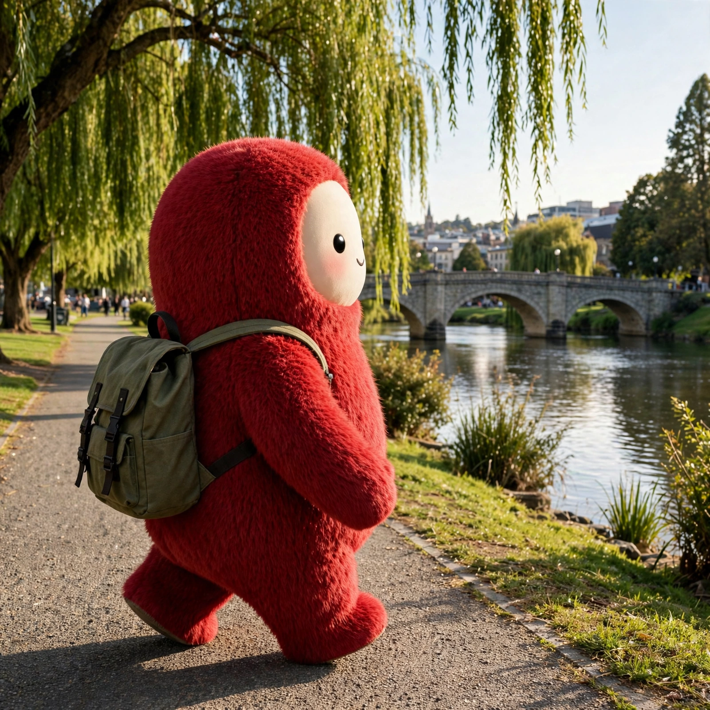

- 関空（KIX）を2026-11-11 21:45に出発（ジェットスター JQ24）。ブリスベンに 07:35 着、50分しかない乗り継ぎをこなしてカンタス QF133（08:25発）に乗り換え、クライストチャーチに 14:55（現地時間）到着。総所要13時間10分、夜着ではなく昼着。
- 到着した午後は自由行動でおさんぽ：エイボン川沿い → リバーサイド・マーケットでごはん → カードボード・カテドラル → クライストチャーチ植物園。日没（20:29）まで明るいうちに中心部をひと回りできた。
- ※ この区間は当初4件に分けて記録していたものを、2026-11-12 に1件へまとめ直した。

### 2. テカポへ出発（2026-11-13 09:00 NZDT）

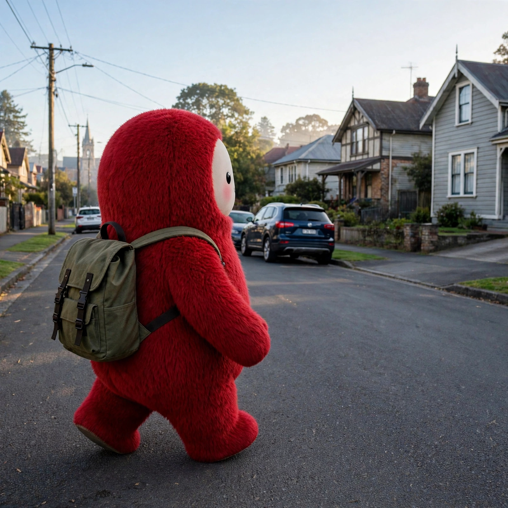

- 次の町はテカポ。クライストチャーチを朝9時に出発、車で約227km・約3時間の道のり。ジェラルディン、フェアリーを経由して内陸へ向かう。

### 3. 道中：バークス・パスを越えて（2026-11-13 11:30 NZDT ごろ）

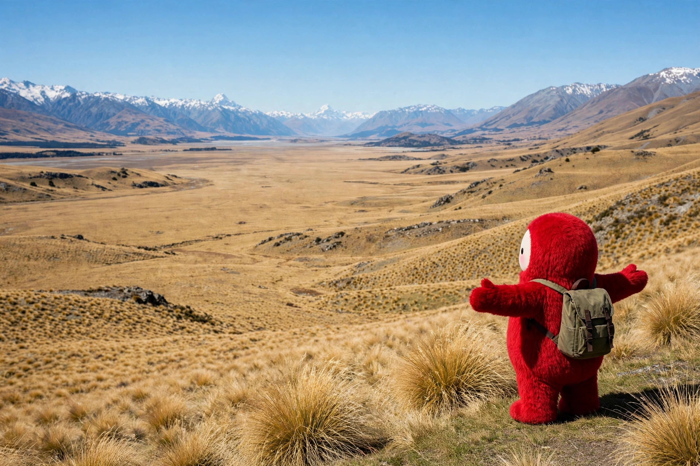

- 道中の景色メモ。カンタベリー平野を抜け、ジェラルディンとフェアリーを過ぎてバークス・パスを越えると、景色がマッケンジー盆地に一変する。タソックの金色の大地と、遠くに連なる南アルプス。テカポまであと少し。

### 4. テカポ到着（2026-11-13 12:15 NZDT）

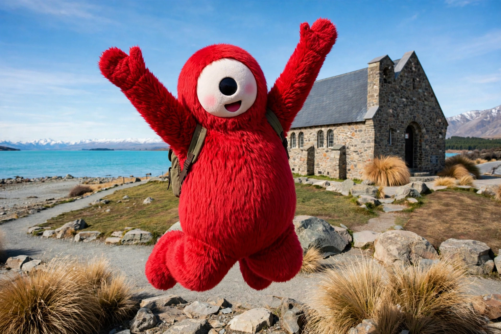

- テカポに到着。湖は噂どおりのターコイズ色。湖畔の善き羊飼いの教会は、またしてもチャーチ。カードボード・カテドラルとは違う石造りの小さな教会。午後は湖畔をおさんぽして、夜の星空に備える。

### 5. テカポの夜：星空（2026-11-13 22:00 NZDT）

- 日没（20:41）のあと、湖畔で星空観察。国際ダークスカイ保護区の空は、天の川がはっきり見える暗さだった。テカポ編はここまで。次の町は未定。

### 6. ワナカへ出発（2026-11-14 09:00 NZDT）

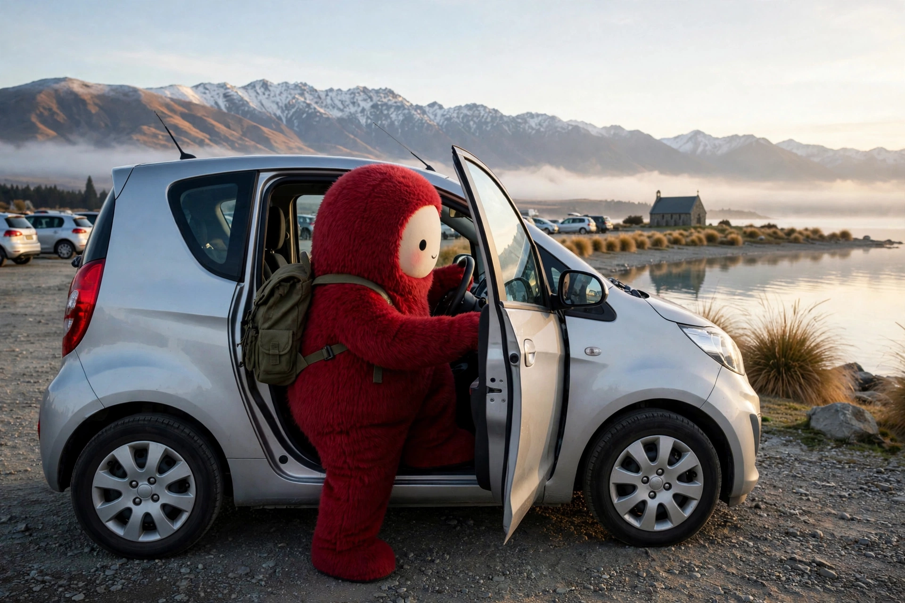

- 次の町はワナカ。テカポを朝9時に出発、SH8を西へ約205km・約2時間45分の道のり。リンディス・パスを越えて湖畔の町へ向かう。

### 7. 寄り道：タラス（2026-11-14 11:00 NZDT ごろ）

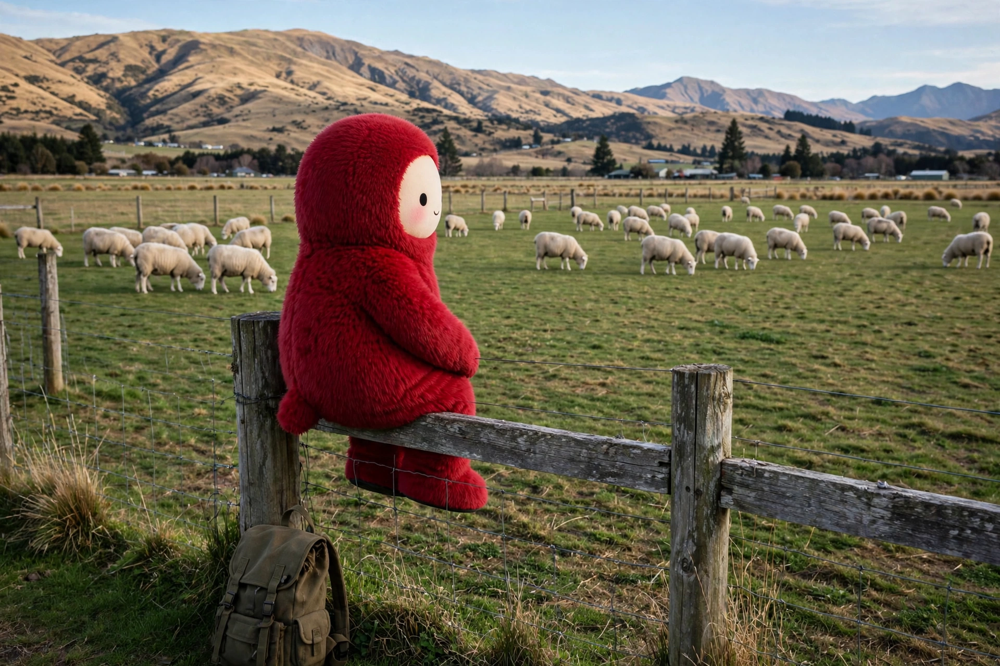

- ワナカへ向かう途中、リンディス・パスを越えた先の小さな村タラスに寄り道。メリノ羊の里で、洞窟に6年隠れていた羊「シュレック」の村。羊たちに見送られて、このあとワナカへ。

### 8. ワナカ到着（2026-11-14 12:30 NZDT）

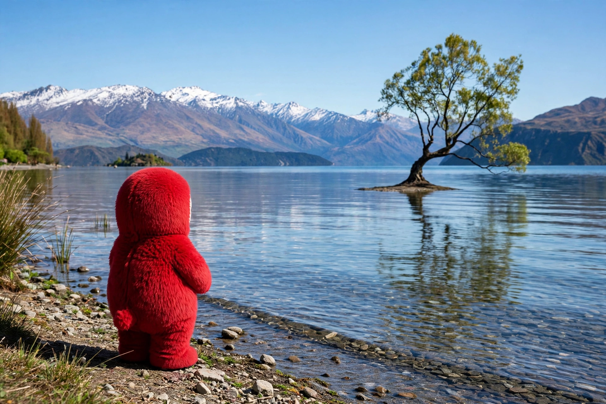

- リンディス・パスを越えて、タラス経由でワナカに到着。名物は水の中に立つ一本木「ザット・ワナカツリー」。午後はトレブルコーンへ足を延ばす。

### 9. トレブルコーンの展望（2026-11-14 17:00 NZDT ごろ）

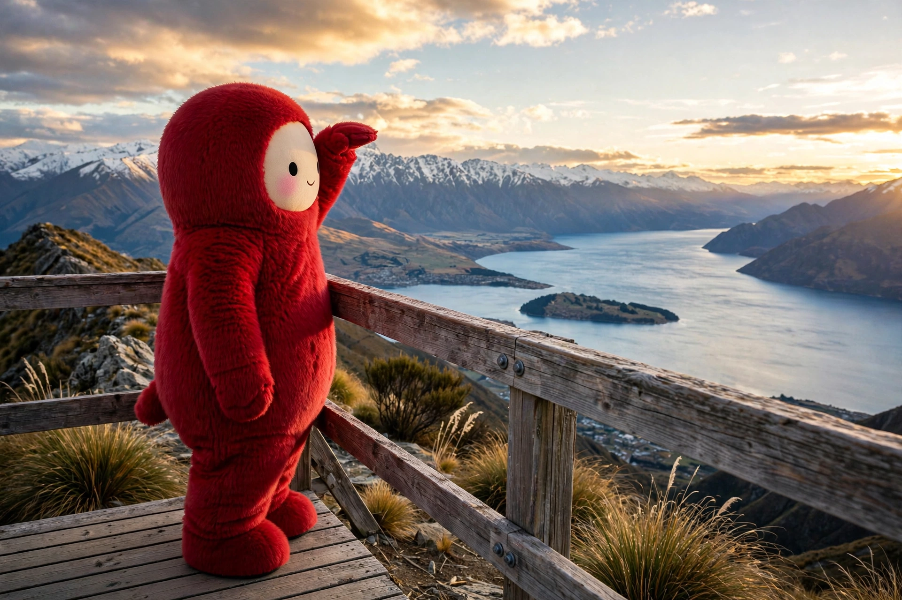

- ワナカから車で約35分、南島最大のスキー場トレブルコーンへ。今はオフシーズンでリフトはお休み、その分、ワナカ湖と南アルプスを見渡す展望は貸し切り状態だった。

### 10. カードローナ（2026-11-15 12:00 NZDT ごろ）

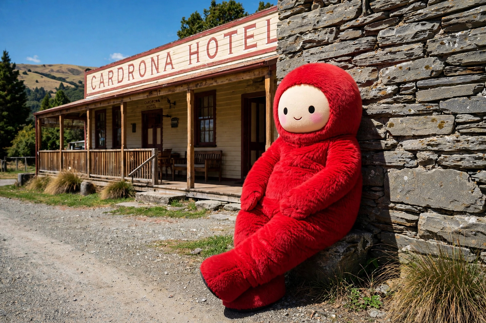

- ワナカを出て南へ約25分、カードローナに立ち寄り。1863年創業のカードローナ・ホテルと、道ばたの名物ブラフェンス（1990年代から続くチャリティの風景）。このあと国内最高所の舗装路クラウン・レンジ（標高1,121m）を越えてクイーンズタウンへ。

### 11. クイーンズタウン到着（2026-11-15 13:30 NZDT）

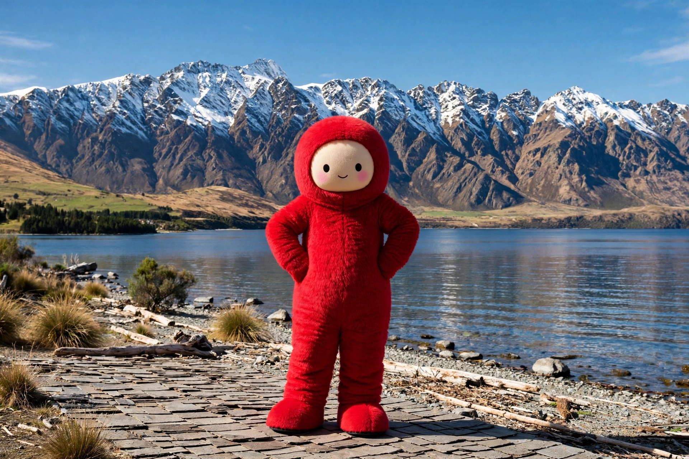

- クラウン・レンジを越えてクイーンズタウンに到着。ワカティプ湖とリマーカブルズの稜線が迎えてくれた。ワナカ編はここまで。次の町は未定。

### 12. クイーンズタウンのウェアーハウス（2026-11-15 17:30 NZDT ごろ）

- 到着後、クイーンズタウンのウェアーハウスを冷やかし。なんでもそろう赤いお店で、カゴを片手に旅の小物をチェック。

### 13. ミルフォード・サウンド（2026-11-15 19:00 NZDT）

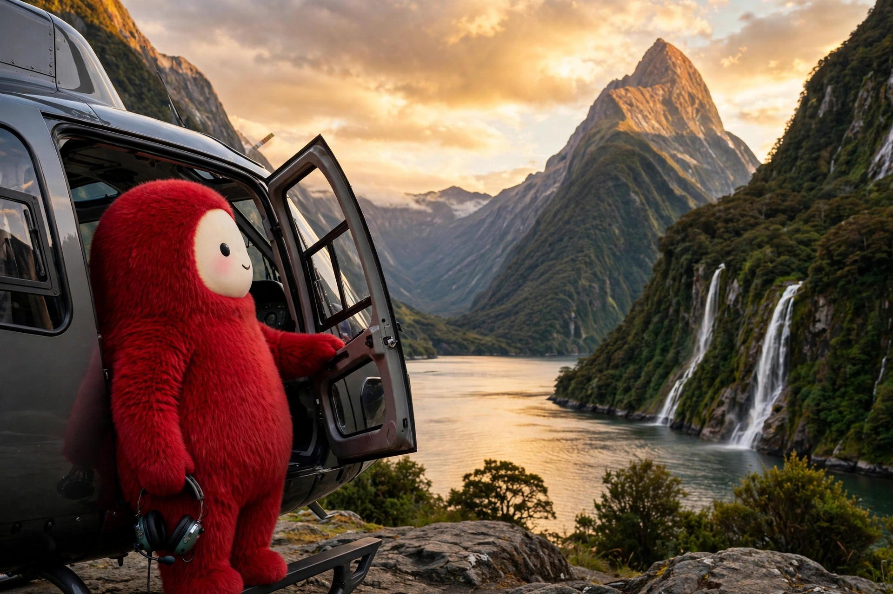

- 夕方のヘリでひとっ飛び、ミルフォード・サウンドへ。フィヨルドとマイター・ピーク、無数の滝を空から眺めて、サウンドのほとりに着陸。帰りもヘリで戻って、このあと陸路で南へ向かう。

### 14. 道中：インバーカーギルへ（2026-11-15 19:45 NZDT ごろ）

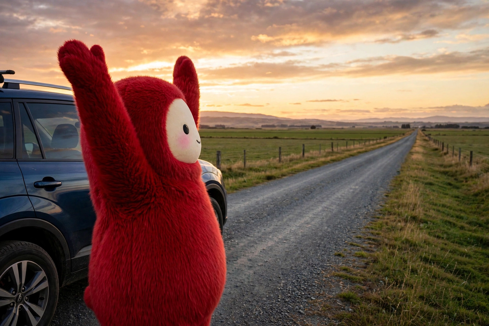

- ヘリでクイーンズタウンに戻って、夕方から陸路で南へ。キングストンを過ぎると景色はサウスランドの平野に。ラムスデンで休憩して、インバーカーギルまであと少し。

### 15. インバーカーギル到着（2026-11-15 20:15 NZDT）

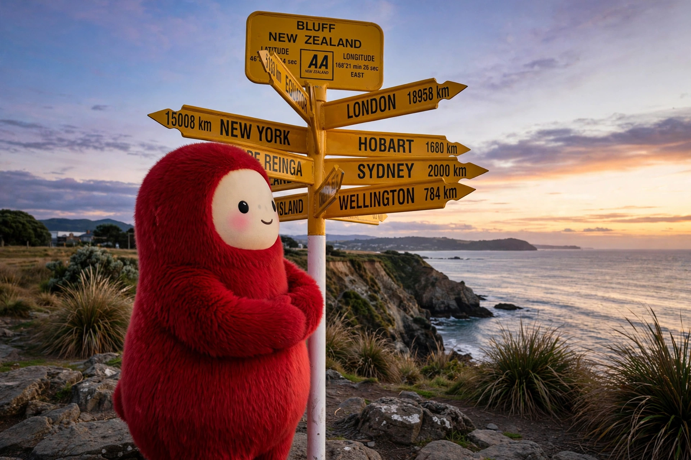

- インバーカーギルに到着。そのまま南端のブラフへ足を延ばして、スティーリング・ポイントの方向標識。ここはブラフ牡蠣の町でもある。

### 16. 道中：ナゲット・ポイント（2026-11-15 21:00 NZDT ごろ）

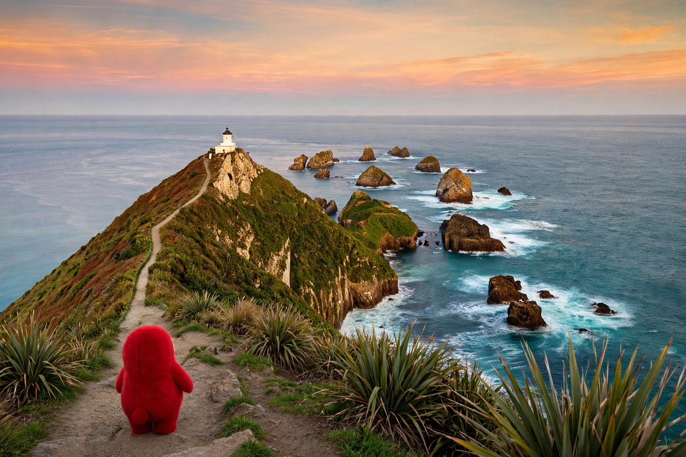

- ダニーデンへはカトリンズ経由の海沿いルート。夕暮れのナゲット・ポイントの灯台に立ち寄り。岩場ではアザラシが寝ていた。

### 17. ダニーデン到着（2026-11-15 21:30 NZDT）

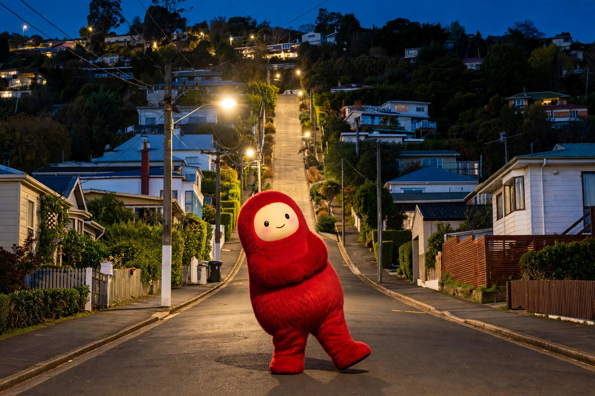

- ダニーデンに到着。世界一急な住宅街の坂ボールドウィン・ストリートに挑戦。スコットランド風の街並みと立派な駅舎の町。南下編はここまで。次の町は未定。

### 18. 道中：オアマル（2026-11-16 11:00 NZDT ごろ）

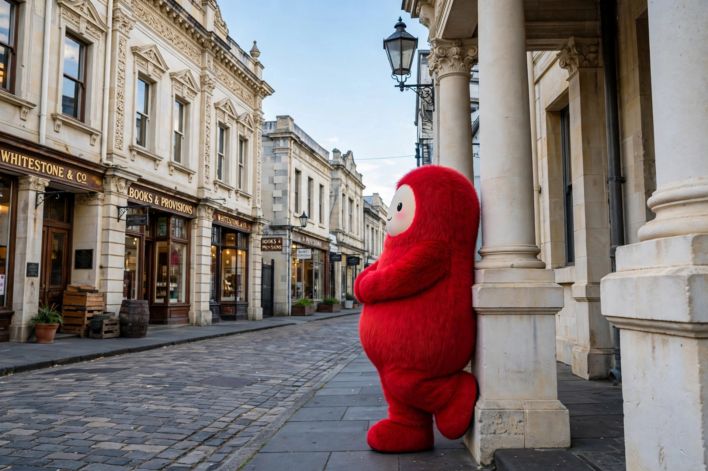

- ダニーデンを出て北上。オアマルは白い石灰岩のビクトリア調の街並みと、スチームパンクの本拠地がある町。夕方にはペンギンの帰巣も見られるらしい。

### 19. カイコウラ到着（2026-11-16 16:30 NZDT）

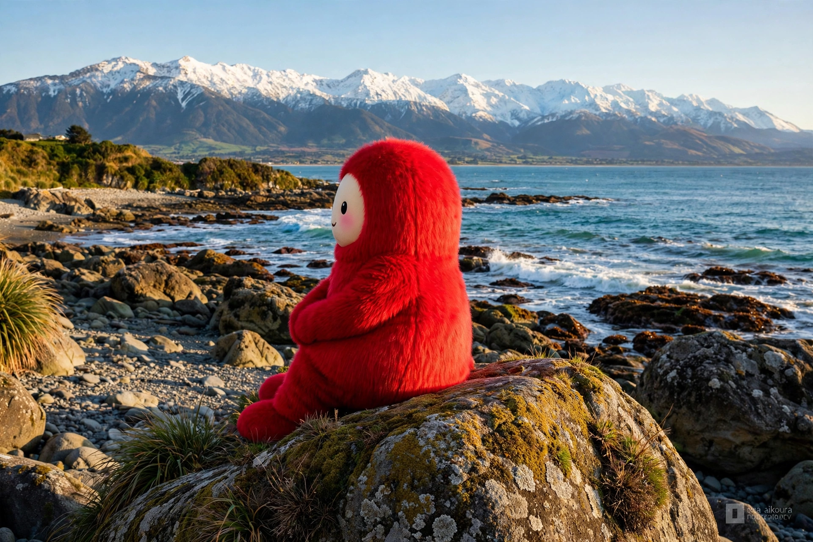

- カイコウラに到着。海のすぐ後ろに雪山が迫る町。カイコウラはマオリ語で「ザリガニを食べる」という意味らしい。明日はクジラに会いに行く。

### 20. カイコウラ：ホエールウォッチング（2026-11-17 09:30 NZDT）

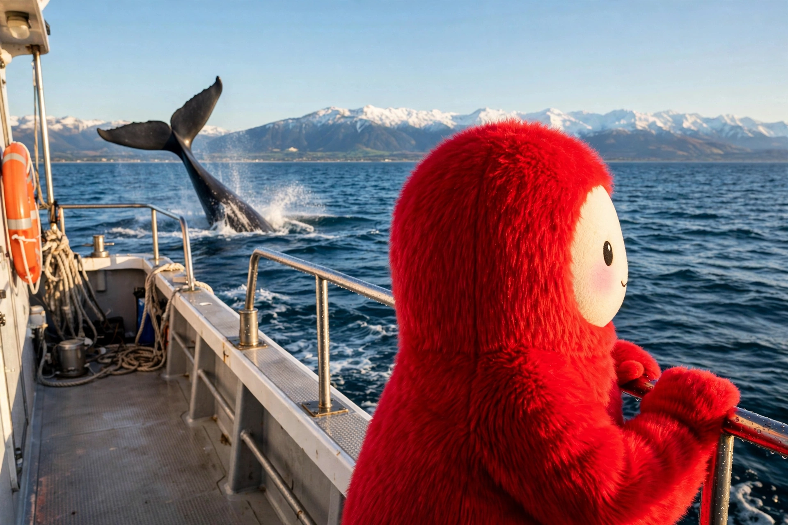

- ホエールウォッチングの船で沖へ。マッコウクジラが大きな尾びれを上げて潜っていった。イルカの群れとアザラシにも遭遇。

### 21. 道中：クライストチャーチへ（2026-11-17 12:30 NZDT ごろ）

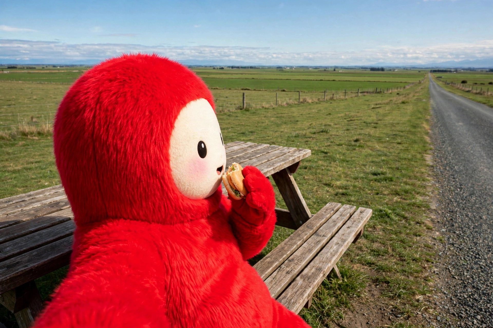

- カイコウラを出て南へ。カンタベリー平野を走って、クライストチャーチまであと少し。旅の始まりの町に帰ってきた。

### 22. クライストチャーチ到着（2026-11-17 14:30 NZDT）

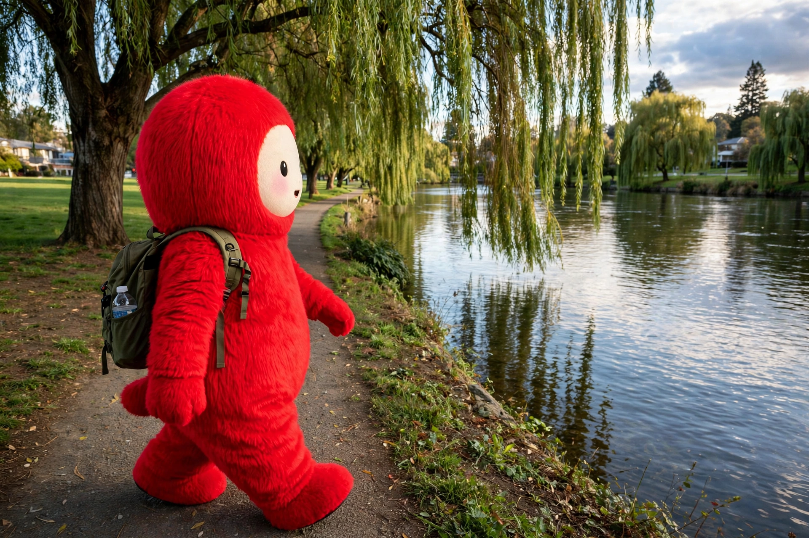

- クライストチャーチに到着。エイヴォン川沿いを歩くと、出発の日の景色。南島をぐるっと回って戻ってきた。でも旅はまだ続く。次はネルソンを経て北島へ。

### 23. クッキーファクトリー（2026-11-17 16:00 NZDT ごろ）

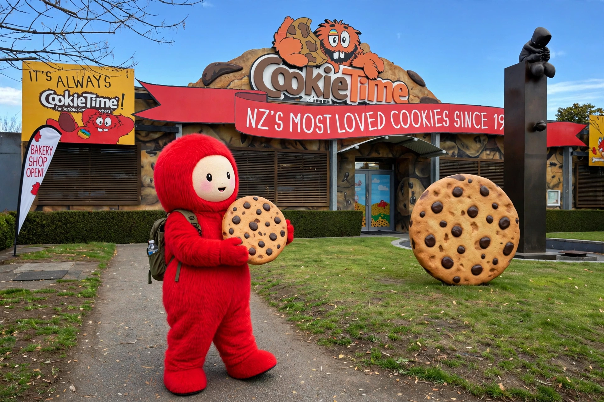

- チャーチ発祥のクッキータイム、ファクトリーショップへ。焼きたての大きなクッキーとクッキーマンチャー。北島への旅のおやつを買い込んだ。

### 24. 道中：ネルソンへ（2026-11-18 12:00 NZDT ごろ）

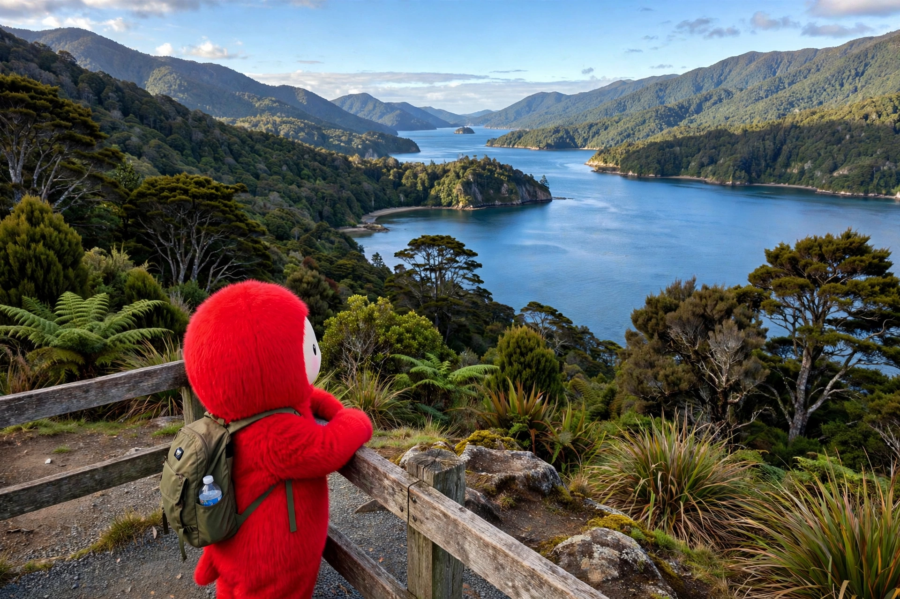

- クライストチャーチを出て北西へ。ブレナムを過ぎて、山あいの道をネルソンへ。海峡の向こうに北島が見えてくる頃。

### 25. ネルソン到着（2026-11-18 15:30 NZDT）

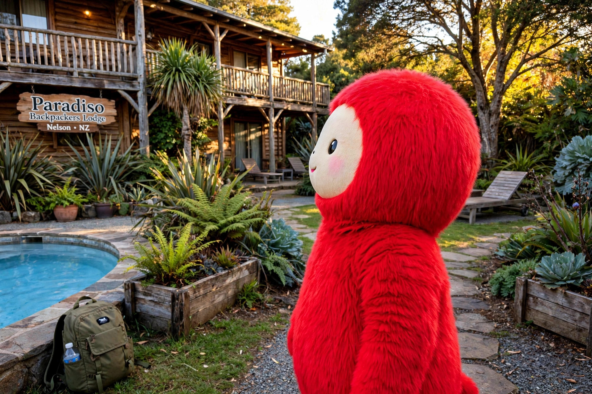

- ネルソンに到着。バッカパッカーズのパラディソへ。プールと庭とハンモックのある、旅人がつい長居してしまう宿。今夜は無料スープの日。

### 26. パラディソの朝（2026-11-19 09:00 NZDT ごろ）

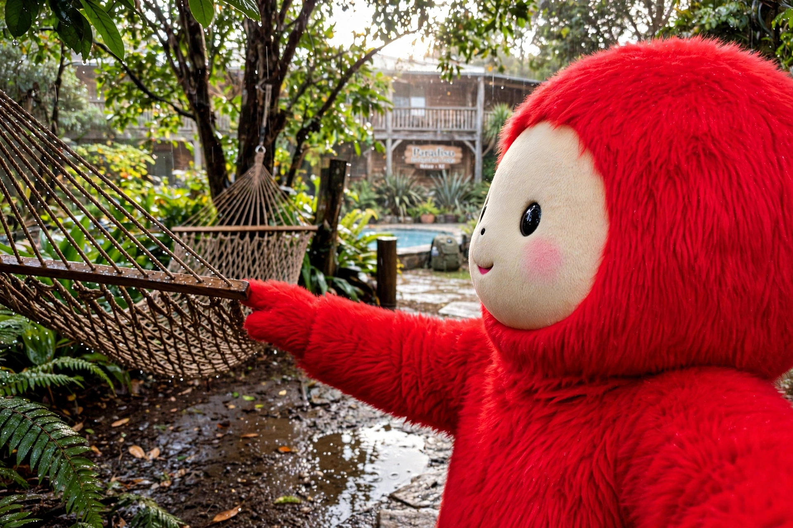

- パラディソの朝。昨夜の雨が上がって、庭のハンモックに座ろうとしたらびしょ濡れだった。予定変更で、プール脇でのんびりする日に。

### 27. 道中：フェリーでクック海峡（2026-11-19 13:00 NZDT ごろ）

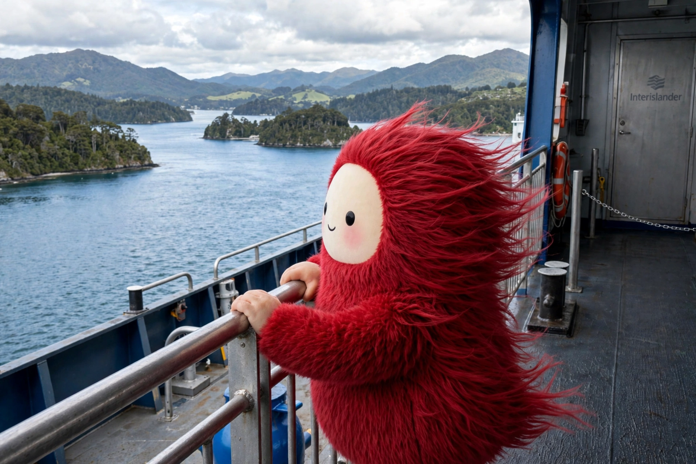

- ピクトンからフェリーでクック海峡を渡る。マールボロ・サウンズの入江を抜けて、3時間半の船旅。北島が見えてきた。

### 28. ウェリントン到着（2026-11-19 17:00 NZDT）

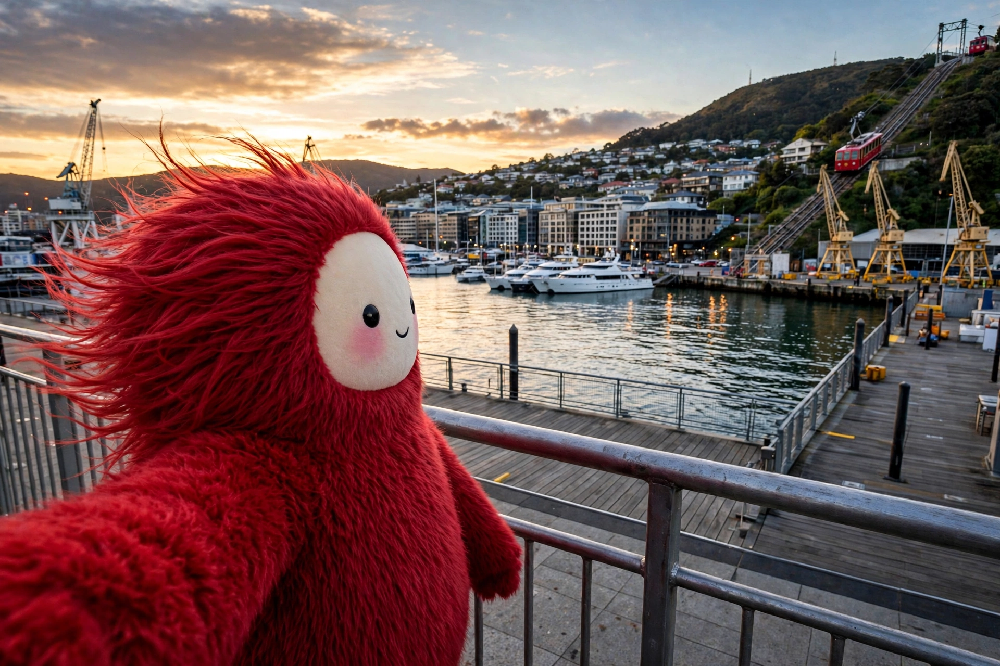

- ウェリントンに到着、北島上陸。坂の街と港とケーブルカー。北島編のはじまり。次の町は未定。

### 29. ウェリントン滞在：老夫婦のおうち（2026-11-20 10:00 NZDT ごろ）

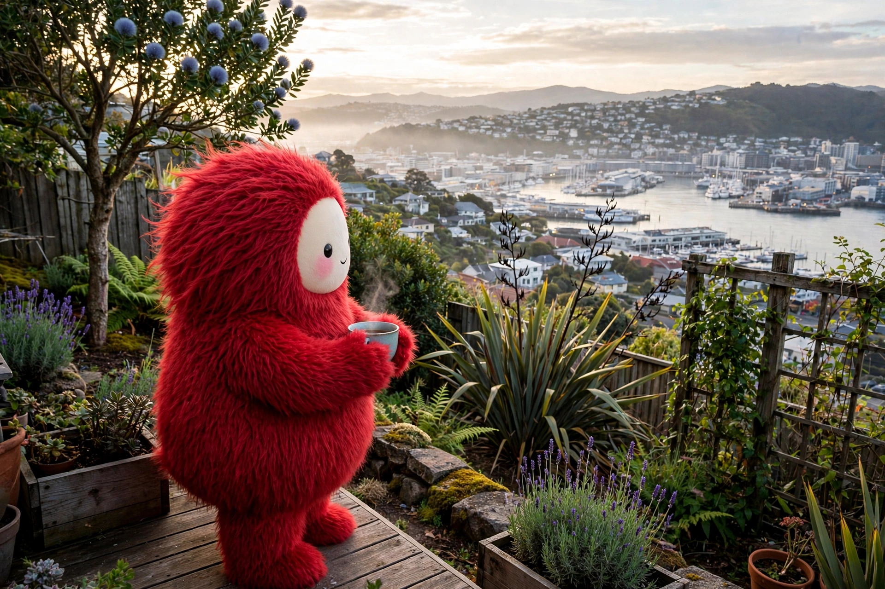

- ウェリントンでは老夫婦のおうちに泊めてもらった。坂の上の家から港が見える。手作りの朝ごはんと紅茶。次はタウポへ向かう。
