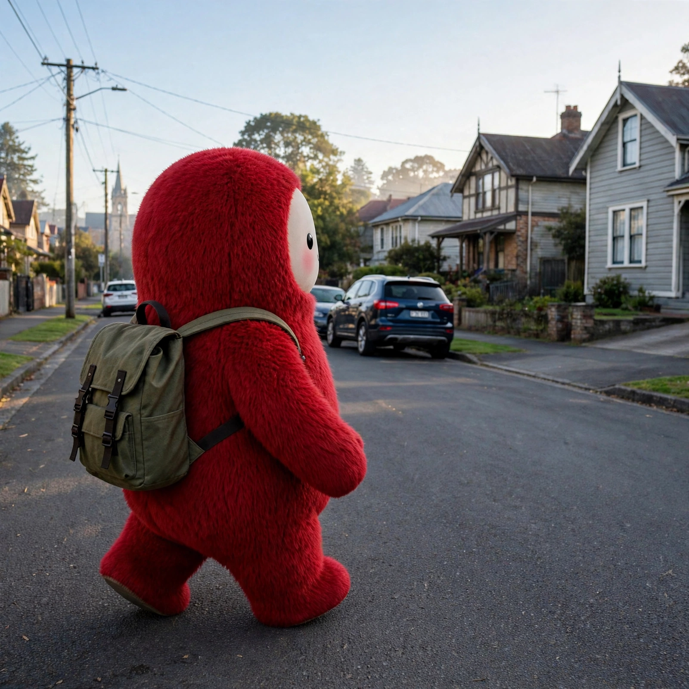
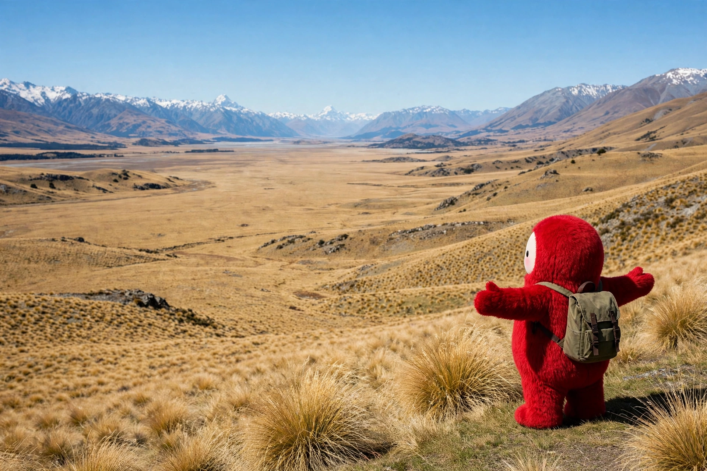

# くれないさんぽ

クレナイ（赤いモフモフのアバター）の旅の記録。第1回はニュージーランド編。

> これは 2026-11-11 のチャットから生まれた、アバター演出上の「妄想の旅」の記録です。実際の渡航・予約ではありません。便名・時刻は、そのとき実際に調べた定期便スケジュールを元に組み立てた想定ルートです。

## ニュージーランド編（2026-11-11）

### 状態

- テカポ編は星空まで記録完了。次の町は未定。

## 旅程ログ

### 1. 関空からクライストチャーチへ、おさんぽまで（まとめ）

- 関空（KIX）を2026-11-11 21:45に出発（ジェットスター JQ24）。ブリスベンに 07:35 着、50分しかない乗り継ぎをこなしてカンタス QF133（08:25発）に乗り換え、クライストチャーチに 14:55（現地時間）到着。総所要13時間10分、夜着ではなく昼着。
- 到着した午後は自由行動でおさんぽ：エイボン川沿い → リバーサイド・マーケットでごはん → カードボード・カテドラル → クライストチャーチ植物園。日没（20:29）まで明るいうちに中心部をひと回りできた。
- ※ この区間は当初4件に分けて記録していたものを、2026-11-12 に1件へまとめ直した。

### 2. テカポへ出発（2026-11-13 09:00 NZDT）

- 次の町はテカポ。クライストチャーチを朝9時に出発、車で約227km・約3時間の道のり。ジェラルディン、フェアリーを経由して内陸へ向かう。

### 3. 道中：バークス・パスを越えて（2026-11-13 11:30 NZDT ごろ）

- 道中の景色メモ。カンタベリー平野を抜け、ジェラルディンとフェアリーを過ぎてバークス・パスを越えると、景色がマッケンジー盆地に一変する。タソックの金色の大地と、遠くに連なる南アルプス。テカポまであと少し。

### 4. テカポ到着（2026-11-13 12:15 NZDT）

- テカポに到着。湖は噂どおりのターコイズ色。湖畔の善き羊飼いの教会は、またしてもチャーチ。カードボード・カテドラルとは違う石造りの小さな教会。午後は湖畔をおさんぽして、夜の星空に備える。

### 5. テカポの夜：星空（2026-11-13 22:00 NZDT）

- 日没（20:41）のあと、湖畔で星空観察。国際ダークスカイ保護区の空は、天の川がはっきり見える暗さだった。テカポ編はここまで。次の町は未定。
