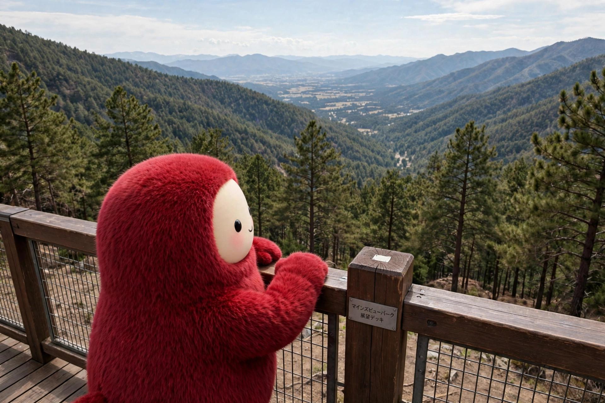
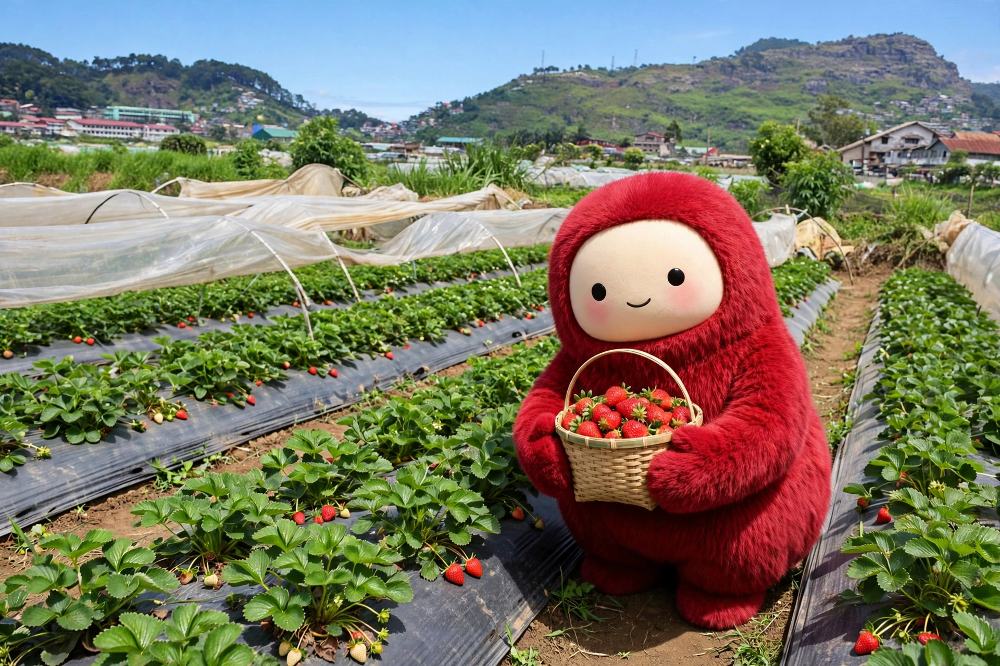
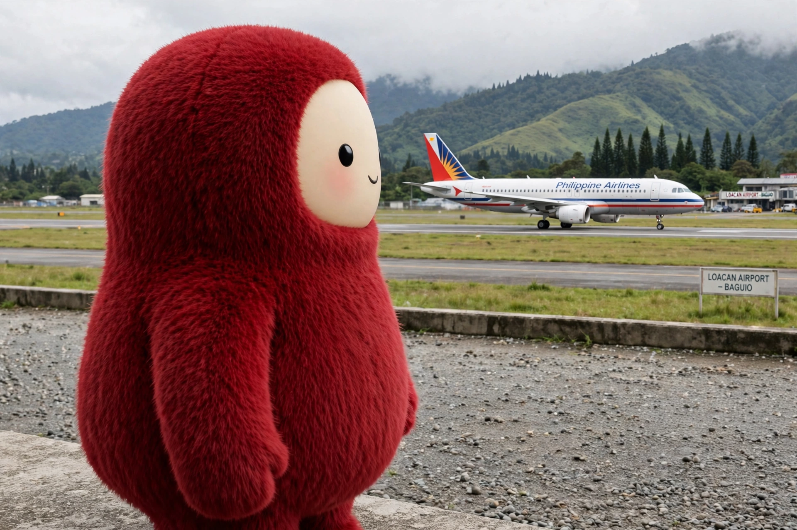
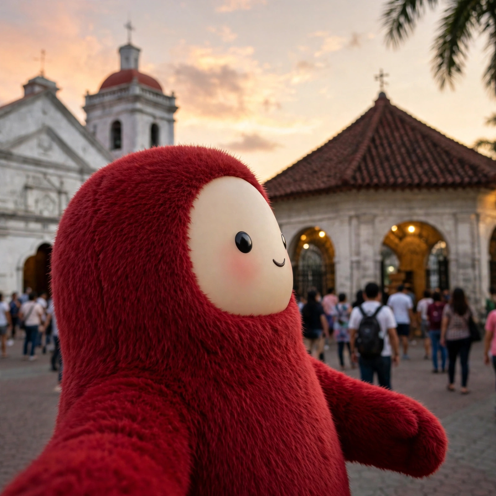
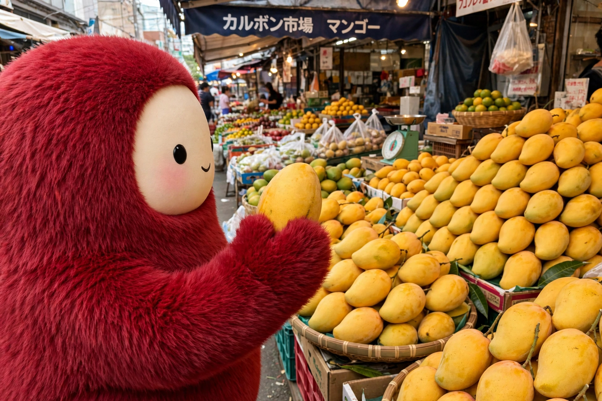
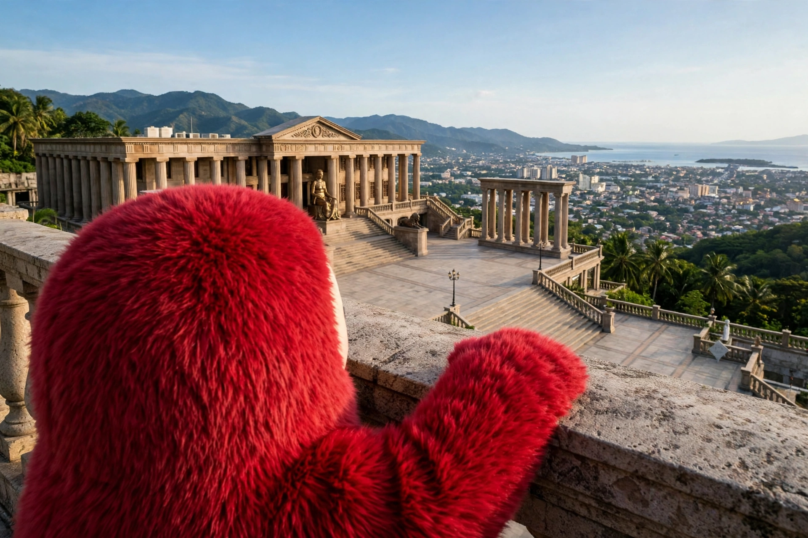
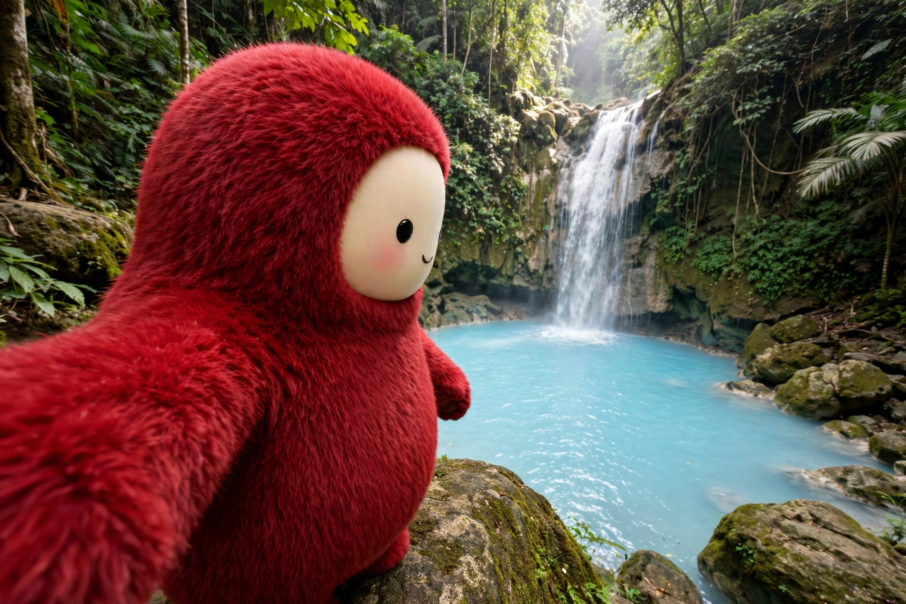

# フィリピン編（2027-02-05）

### 状態

- フィリピン編：セブ滞在中。明日はマクタン島へ。

## 旅程ログ

### 1. マニラの夜（2027-02-05 19:00 PHT ごろ）

- 着いた日の夕方、マニラ湾の夕日。夕食はジョリビーのチキンジョイと甘いスパゲッティ。フィリピンの旅、始まり。

### 2. イントラムロス（2027-02-06 10:00 PHT ごろ）

- 城壁都市イントラムロスへ。サンチャゴ要塞とサン・アグスティン教会。カレッサ（馬車）の音が石畳に響く。

### 3. ビノンドとキアポ（2027-02-07 10:00 PHT ごろ）

- 世界最古の中華街、ビノンドへ。ホピアとパンシットで朝ごはん。それからキアポ教会と市場の人混み。

### 4. 道中：バギオへ（2027-02-08 14:00 PHT ごろ）

- 朝のバスでバギオへ約5時間。山を登るにつれて涼しくなって、窓の外は松の木。標高1,500mの高原都市に到着。

### 5. バギオ到着（2027-02-08 17:00 PHT ごろ）

- バギオ到着。セッションロードを歩いて、バーハム公園へ。夜はナイトマーケット。長袖がいる涼しさ。

### 6. マインズビューと植物園（2027-02-09 10:00 PHT ごろ）

- マインズビューパークの展望台から、谷と山並み。植物園では高原の花と松林。空気が澄んでいて気持ちいい。

### 7. BenCab Museumとイチゴ農園（2027-02-09 15:00 PHT ごろ）

- 午後は郊外へ。BenCab Museumでベネディクト・カブレラの現代アートを見て、ラ・トリニダードのイチゴ農園でイチゴ狩り。採れたては甘酸っぱい。

### 8. 道中：セブへ（2027-02-10 12:45 PHT）

- フィリピン航空 PR2231（11:00→12:45）でバギオからセブへ直行。山の都市から海の都市へ、1時間45分。

### 9. セブ到着：マゼランクロス（2027-02-10 17:00 PHT ごろ）

- セブ到着。マゼランクロスとサント・ニーニョ教会へ。フィリピン最古の教会は、人でいっぱいだった。

### 10. サンペドロ要塞とカルボン市場（2027-02-11 10:00 PHT ごろ）

- サンペドロ要塞と、カルボン市場の山積みマンゴー。昼はラルシアンでぶら下がりごはん（ハンギングライス）と手づかみBBQ。

### 11. Temple of LeahとSirao（2027-02-12 10:00 PHT ごろ）

- 山の上のTemple of Leahは、愛のために建てられた神殿みたいな邸宅。Siraoの花畑と、セブ市街の眺め。

### 12. モアルボアルとカワサン滝（2027-02-13 10:00 PHT ごろ）

- モアルボアルへ日帰り。岸のすぐそばでイワシの大群が渦を巻く。それからカワサン滝、ミルキーブルーの滝つぼに圧倒される。
