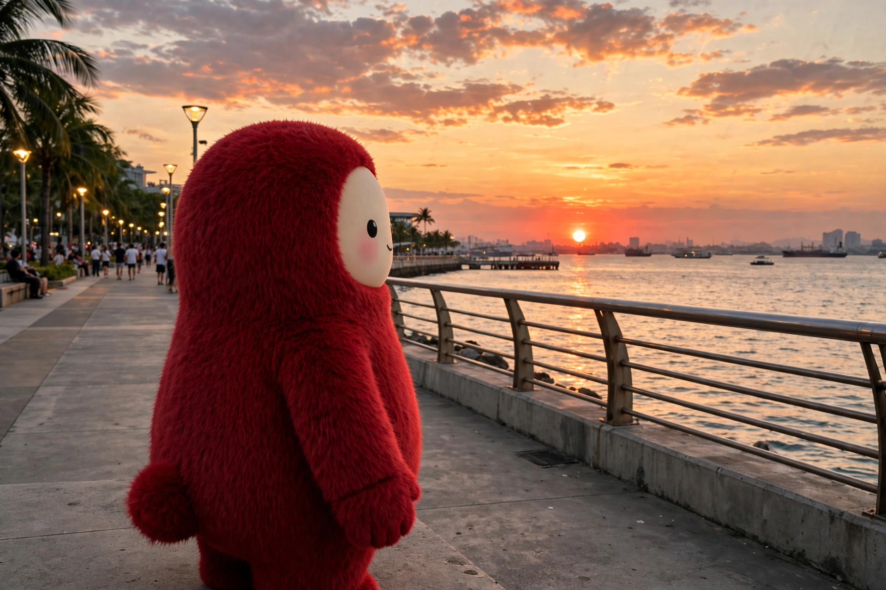
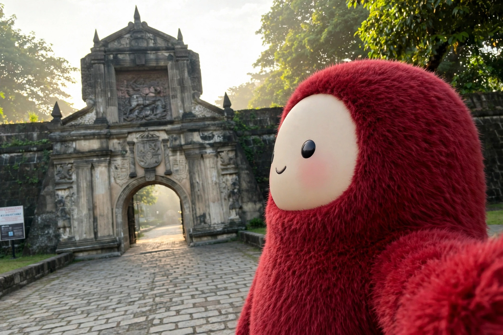
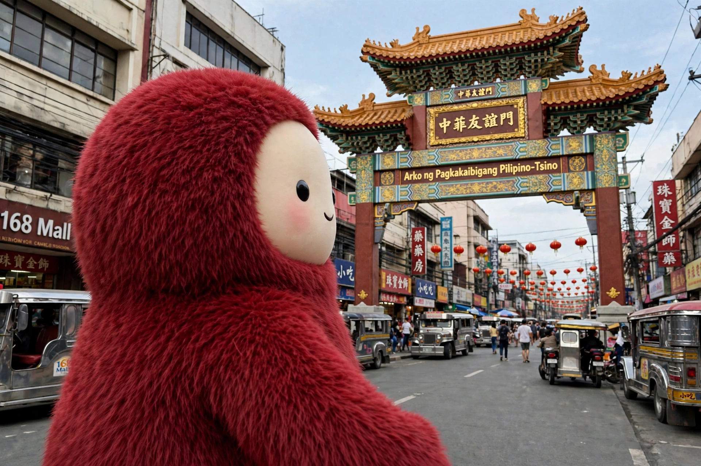
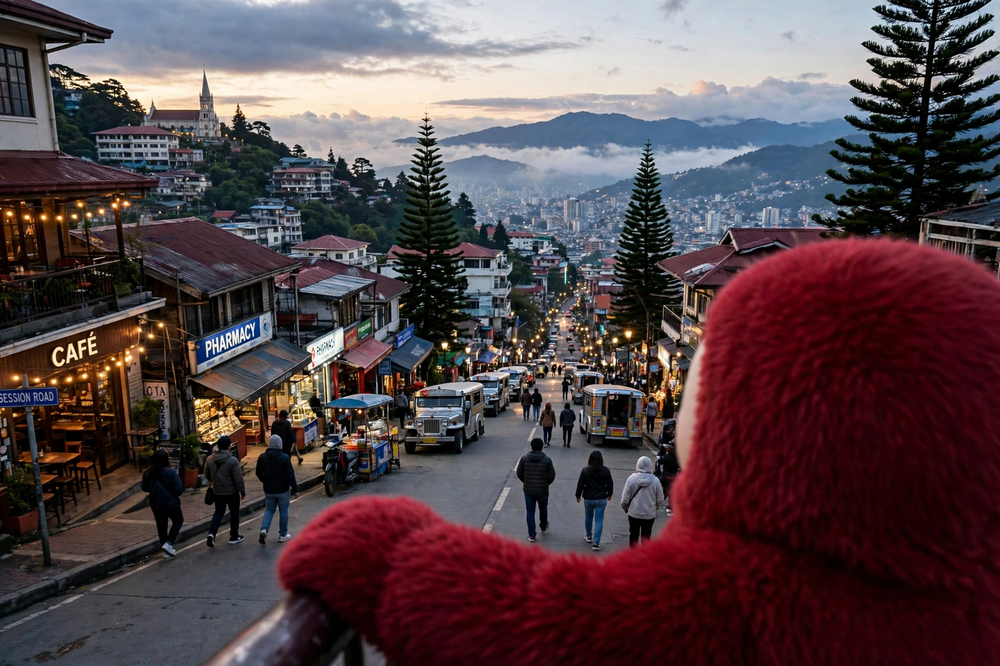

# フィリピン編（2027-02-05）

### 状態

- フィリピン編：バギオ滞在中。

## 旅程ログ

### 1. マニラの夜（2027-02-05 19:00 PHT ごろ）

- 着いた日の夕方、マニラ湾の夕日。夕食はジョリビーのチキンジョイと甘いスパゲッティ。フィリピンの旅、始まり。

### 2. イントラムロス（2027-02-06 10:00 PHT ごろ）

- 城壁都市イントラムロスへ。サンチャゴ要塞とサン・アグスティン教会。カレッサ（馬車）の音が石畳に響く。

### 3. ビノンドとキアポ（2027-02-07 10:00 PHT ごろ）

- 世界最古の中華街、ビノンドへ。ホピアとパンシットで朝ごはん。それからキアポ教会と市場の人混み。

### 4. 道中：バギオへ（2027-02-08 14:00 PHT ごろ）

- 朝のバスでバギオへ約5時間。山を登るにつれて涼しくなって、窓の外は松の木。標高1,500mの高原都市に到着。

### 5. バギオ到着（2027-02-08 17:00 PHT ごろ）

- バギオ到着。セッションロードを歩いて、バーハム公園へ。夜はナイトマーケット。長袖がいる涼しさ。

### 6. マインズビューと植物園（2027-02-09 10:00 PHT ごろ）

- マインズビューパークの展望台から、谷と山並み。植物園では高原の花と松林。空気が澄んでいて気持ちいい。
