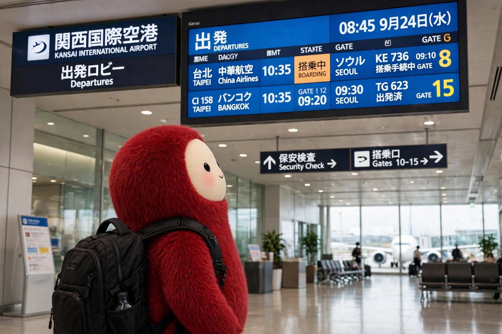

# 台湾編（2027-01-13）

### 状態

- 台湾編：台北滞在中（士林夜市で食べ歩き）。

## 旅程ログ

### 1. 関空から台北へ出発（2027-01-13 07:50 JST）

- 3つ目の旅は台湾。関空 07:50発のピーチ MM23 で台北（桃園）へ。飛行機は約3時間、時差は1時間。近いのに、初めての国。

### 2. 台北到着（2027-01-13 09:55 CST）

- 桃園空港に 09:55 着。空港MRTで台北駅へ。タイの暑さとは違う、しっとりした冬の空気。台湾編、はじまり。

### 3. 士林夜市（2027-01-13 19:00 CST ごろ）

- 夜は士林夜市へ。顔より大きい鶏排に、胡椒餅、マンゴーかき氷は冬でもあった。初日から食べ歩き全開。
