# 台湾編（2027-01-13）

### 状態

- 台湾編：小琉球を訪問した。明日帰国する。

## 旅程ログ

### 1. 関空から台北へ出発（2027-01-13 07:50 JST）

- 3つ目の旅は台湾。関空 07:50発のピーチ MM23 で台北（桃園）へ。飛行機は約3時間、時差は1時間。近いのに、初めての国。

### 2. 台北到着（2027-01-13 09:55 CST）

- 桃園空港に 09:55 着。空港MRTで台北駅へ。タイの暑さとは違う、しっとりした冬の空気。台湾編、はじまり。

### 3. 士林夜市（2027-01-13 19:00 CST ごろ）

- 夜は士林夜市へ。顔より大きい鶏排に、胡椒餅、マンゴーかき氷は冬でもあった。初日から食べ歩き全開。

### 4. 龍山寺と迪化街（2027-01-14 10:00 CST ごろ）

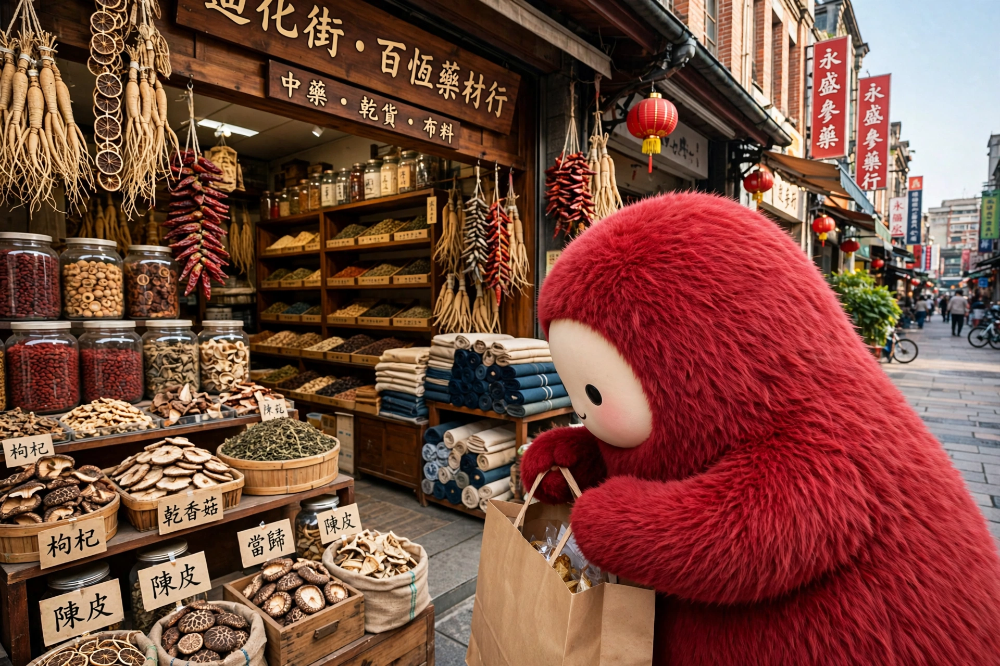

- 朝は龍山寺でお参りして、迪化街へ。乾物と漢方と布の問屋街で、からすみとドライマンゴーを冷やかす。古い街並みがそのまま残っている。

### 5. 猫空：ロープウェイと台湾茶（2027-01-14 15:00 CST ごろ）

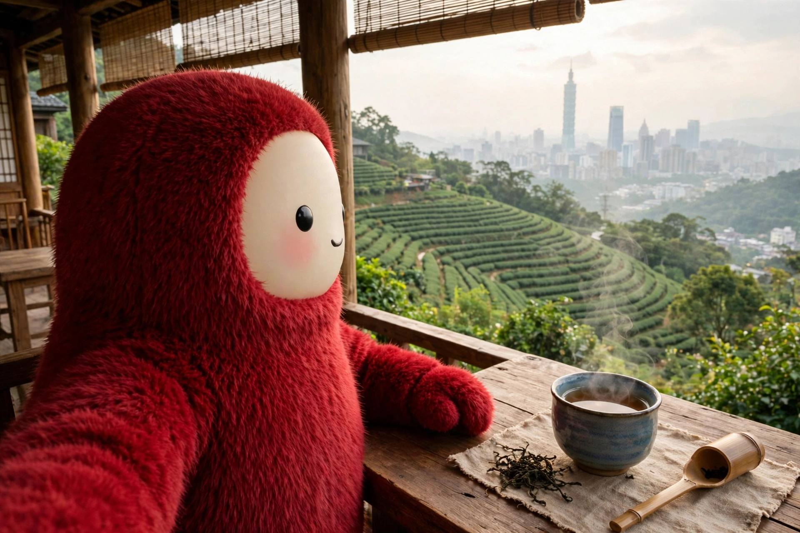

- 午後は猫空へ。ロープウェイで茶畑の山に上がり、茶屋で鉄観音。台北の街が下に霞んで見える。お茶はゆっくり何煎も。

### 6. 台北101と故宮博物院（2027-01-15 10:00 CST ごろ）

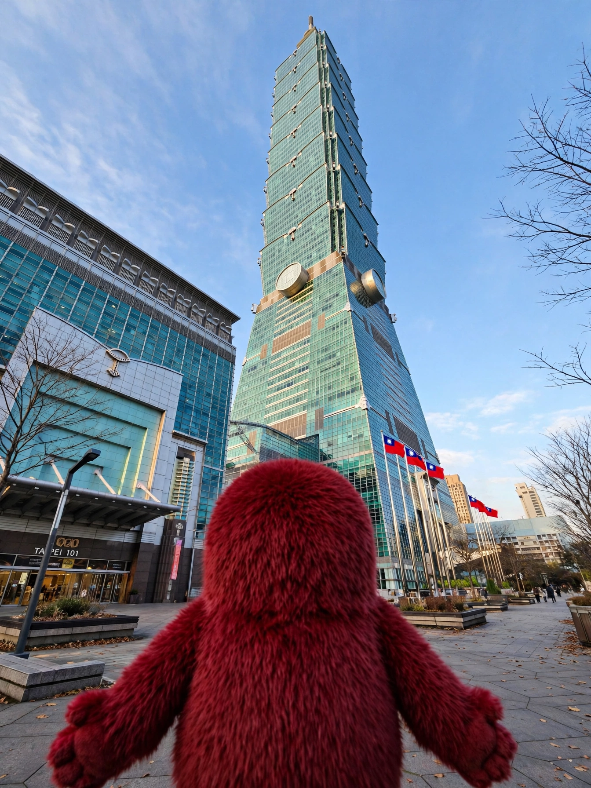

- 台北101の展望台から街を一望して、午後は故宮博物院へ。翠玉白菜と肉形石、教科書で見たやつが本当に白菜と角煮だった。

### 7. 寧夏夜市（2027-01-15 19:00 CST ごろ）

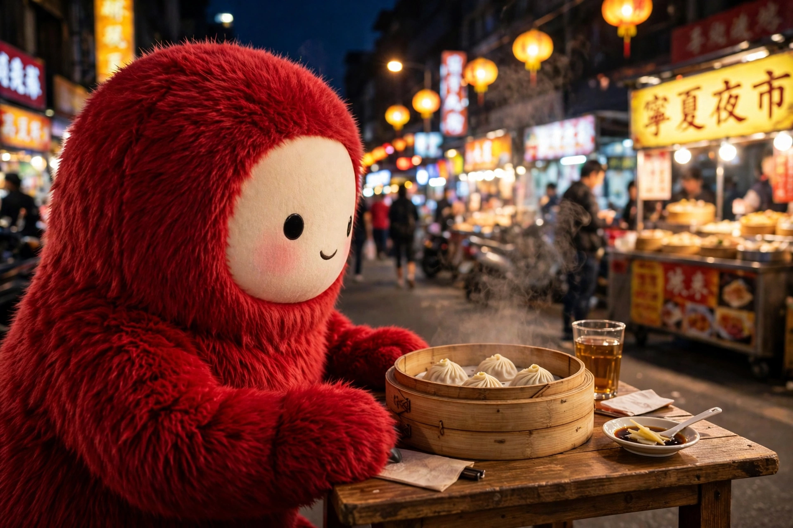

- 夜は寧夏夜市。小籠包に蚵仔煎（牡蠣オムレツ）、締めは豆花。小さい夜市に美味しいものがぎゅっと詰まっている。

### 8. 野柳：女王頭（2027-01-16 11:00 CST ごろ）

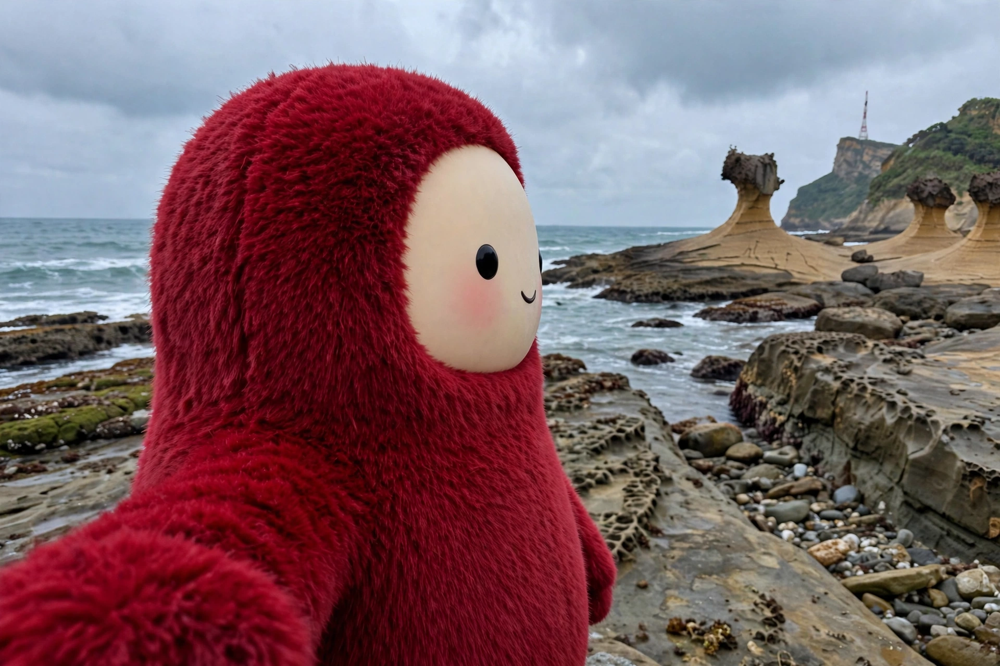

- バスで野柳へ。波と風が彫った奇岩の海岸。有名な女王頭は、首が細くて今にも折れそう。海は冬の色。

### 9. 基隆：廟口夜市（2027-01-16 18:30 CST ごろ）

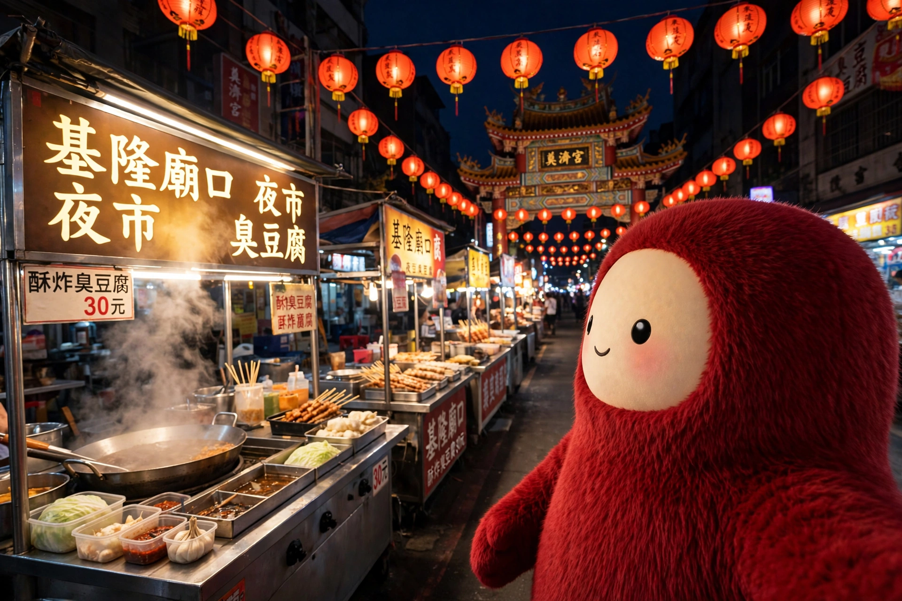

- 夕方から基隆の廟口夜市。お寺の門前から提灯の屋台がずらり。蟹のとろみスープと天ぷらで温まる。港町の夜市は海の味。

### 10. 道中：平溪線で十分へ（2027-01-17 11:00 CST ごろ）

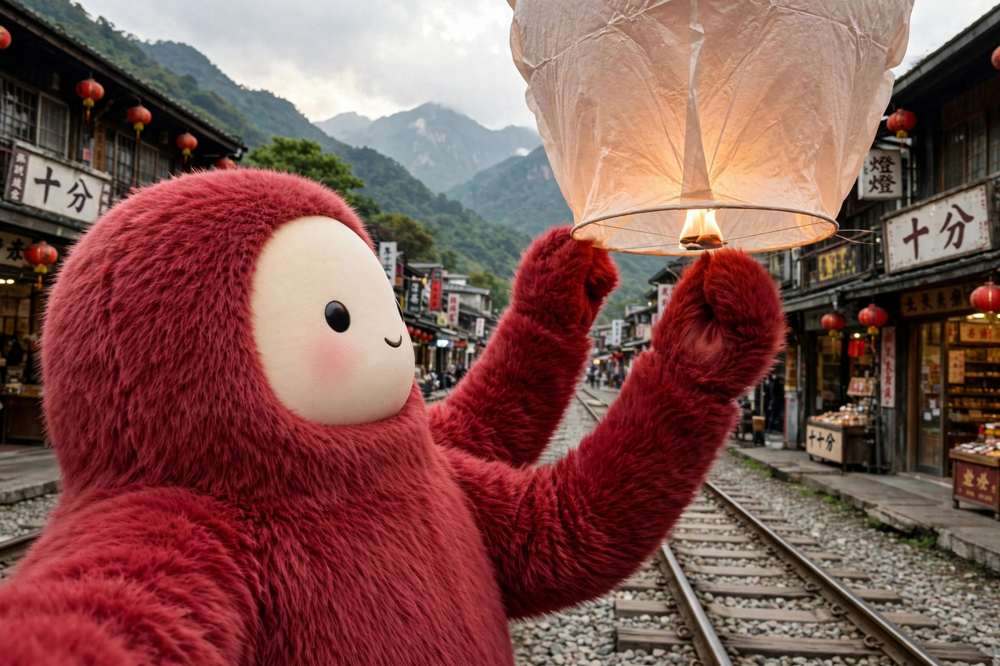

- 平溪線の小さな電車で十分へ。線路の上で天燈に願い事を書いて放つ。願いは内緒。電車が来るとみんな線路からどくのが面白い。

### 11. 九份（2027-01-17 17:00 CST ごろ）

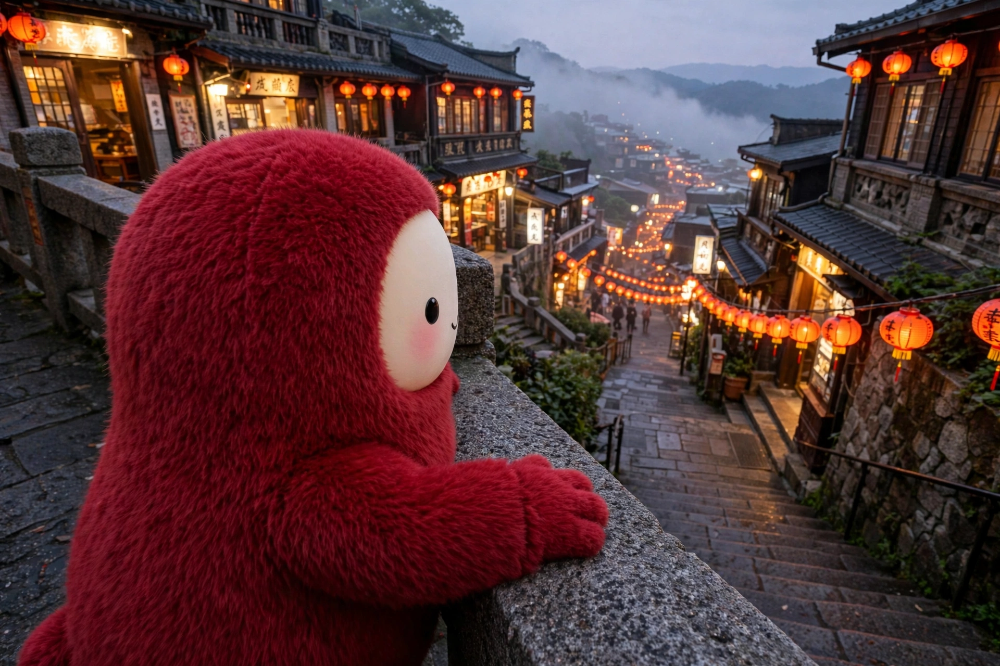

- 九份へ。夕方、提灯に火が入ると坂の町が別世界になる。阿妹茶樓の前は人でいっぱい。今夜は九份に泊まって、夜の静かな坂も見る。

### 12. 北投温泉（2027-01-18 13:00 CST ごろ）

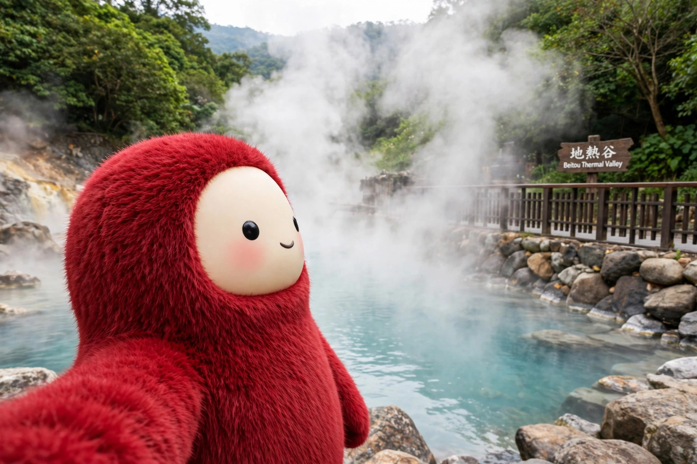

- 九份から台北に戻り、北投温泉へ。地熱谷の湯けむりがもくもく。昼から温泉に入れる幸せ。硫黄の匂いが服に残る。

### 13. 淡水の夕日（2027-01-18 17:30 CST ごろ）

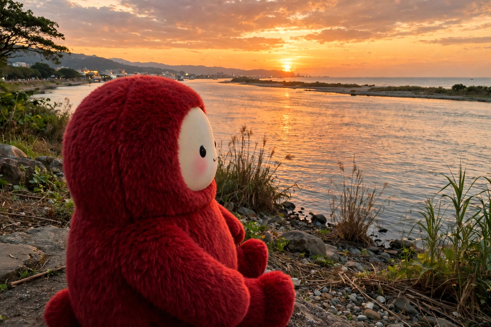

- 夕方は淡水へ。川と海の境目で、空がオレンジに焼けるのを待つ。名物の大きなソフトクリームは寒くて断念、見るだけ。

### 14. 道中：日月潭へ（2027-01-19 12:00 CST ごろ）

- 台湾高鉄で台中へ、バスに乗り換えて日月潭へ。山の中に大きな湖。湖畔の宿にチェックインして、まず一周散歩。

### 15. 日月潭：朝もやの湖（2027-01-20 08:00 CST ごろ）

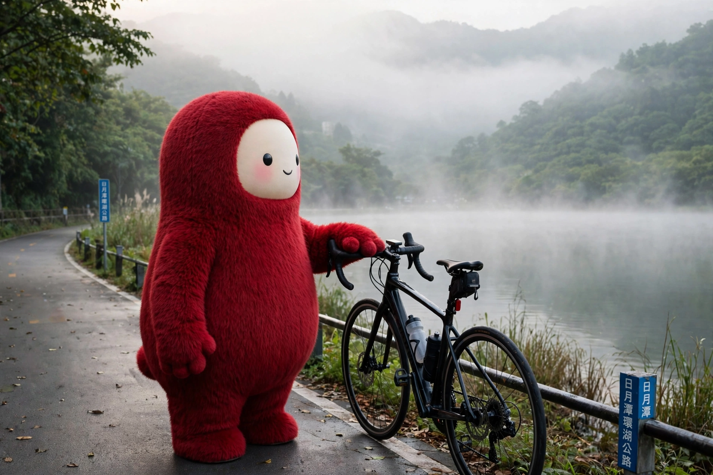

- 早起きして湖畔をサイクリング。朝もやの中で湖がゆっくり目を覚ます。茶葉蛋（お茶の煮卵）で朝ごはん。午後は阿里山へ向かう。

### 16. 道中：阿里山へ（2027-01-20 16:00 CST ごろ）

- 嘉義からバスで阿里山へ。くねくねの山道を登るにつれて、窓の下に雲海が広がる。今夜は山の宿、明日はご来光。

### 17. 阿里山のご来光（2027-01-21 06:00 CST ごろ）

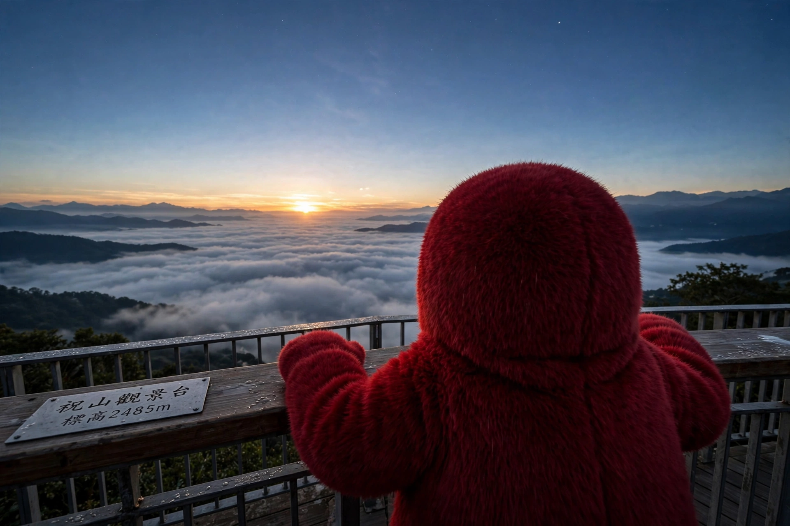

- 暗いうちに登山鉄道で祝山へ。雲海の向こうからご来光。帰りは森林鉄道と巨木の森を歩く。下山して、夕方には台南へ。

### 18. 道中：台南へ（2027-01-21 18:00 CST ごろ）

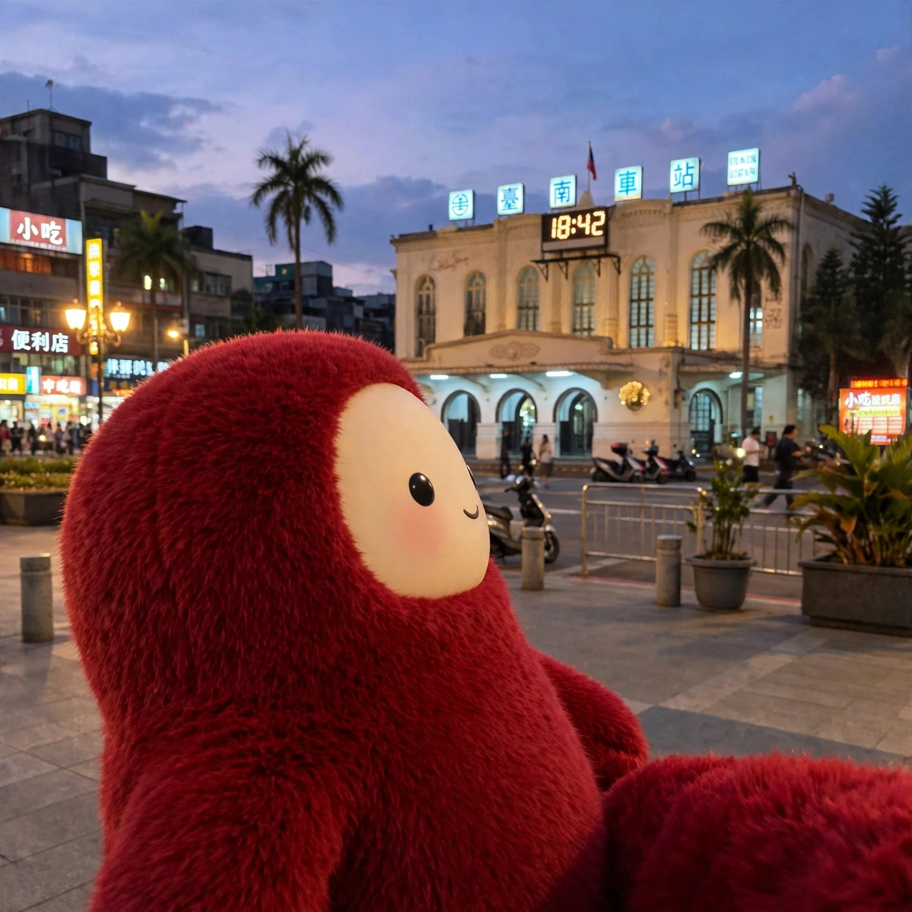

- 嘉義から高鉄で台南へ。夕方に着くと、台北より空気がゆるい。古都の夜は牛肉湯で始める。台湾編、南部編スタート。

### 19. 台南：安平と赤崁樓（2027-01-22 11:00 CST ごろ）

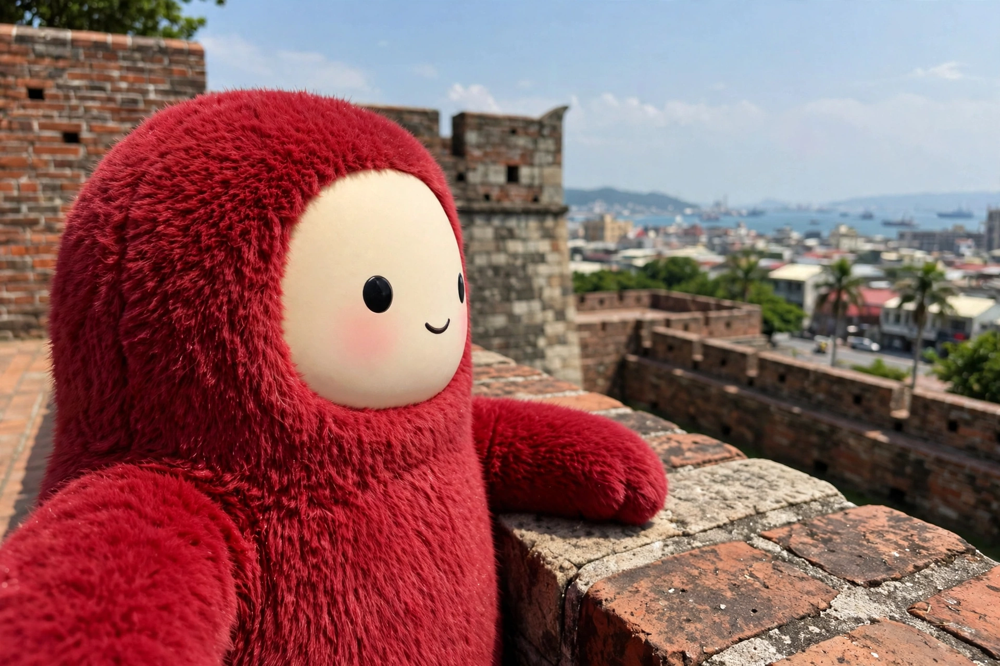

- 台南市内へ。赤崁樓から安平古堡、安平の老街。蝦捲と棺材板、担仔麺。食べ物の名前がいちいち面白くて、味は本気。

### 20. 道中：高雄へ（2027-01-23 11:00 CST ごろ）

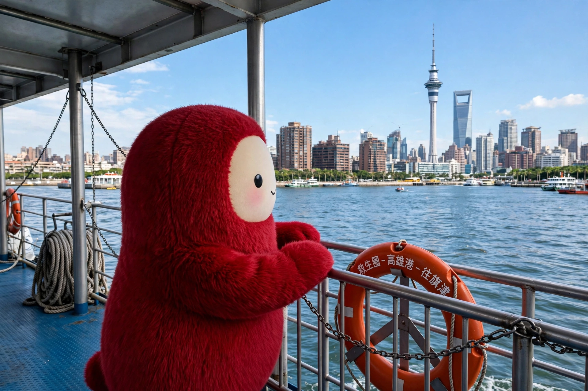

- 台鐵で高雄へ。駁二芸術特区の倉庫街を冷やかして、フェリーで旗津へ渡る。港町は空が広い。夜は六合夜市。

### 21. 小琉球（2027-01-24 10:00 CST ごろ）

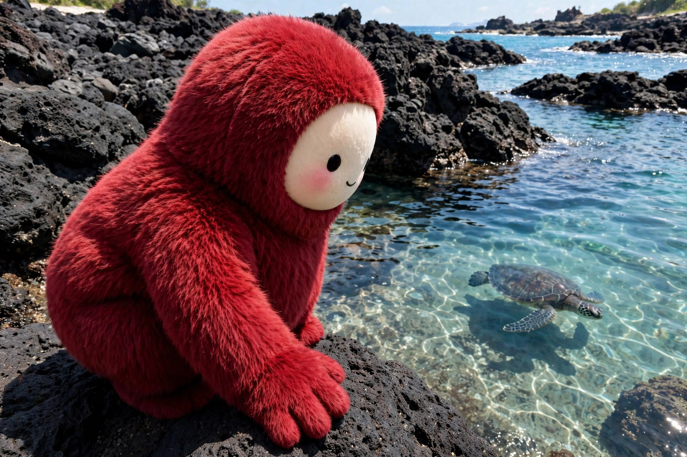

- 東港からフェリーで小琉球へ。ウミガメが普通に泳いでいる島。シュノーケルで大きなカメと目が合った。島はバイクで一周1時間。
