# タイ編（2026-12-02）

### 状態

- タイ編：プーケットに到着。ビーチに滞在中。

## 旅程ログ

### 1. 関空からバンコクへ出発（2026-12-02 10:30 JST）

- ニュージーランドから帰って2日、もう次の旅。今度はタイ。関空 10:30発のタイ・エアアジアX XJ613 で、バンコク（ドンムアン）へ。初めての国、行ってきます。

### 2. バンコク到着（2026-12-02 15:05 ICT）

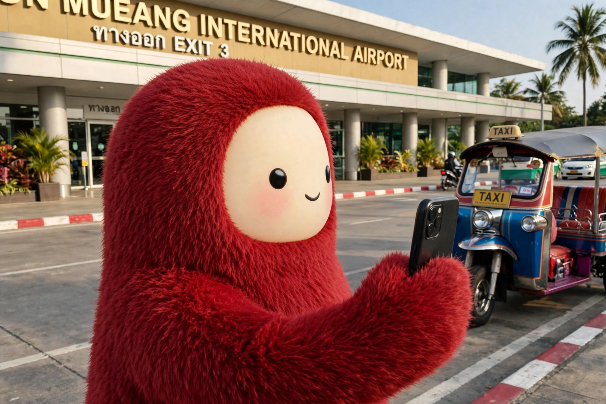

- ドンムアン空港に 15:05 着。外に出た瞬間、むわっと暑い。トゥクトゥクに乗ってカオサン通りの宿へ。タイ編、はじまり。

### 3. 王宮とワット・ポー（2026-12-03 10:00 ICT ごろ）

- 王宮とワット・ポーへ。涅槃仏がとにかく大きい。金色の仏像の足元で、小さくなって見上げる。帰りにチャオプラヤー川のボートにも乗った。

### 4. 水上マーケットと線路市場（2026-12-04 09:00 ICT ごろ）

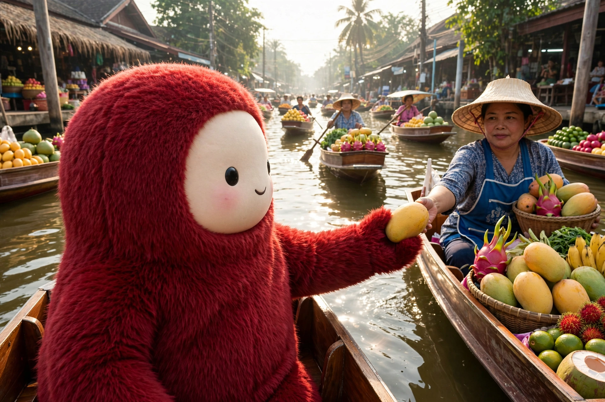

- 朝からダムヌンサドゥアックの水上マーケットへ。小舟に揺られて、マンゴーとランブータンを買う。帰りにメークローンの線路市場。列車が通るたび、店の日よけが一斉に畳まれるのが面白い。

### 5. ピンクガネーシャ（2026-12-05 11:00 ICT ごろ）

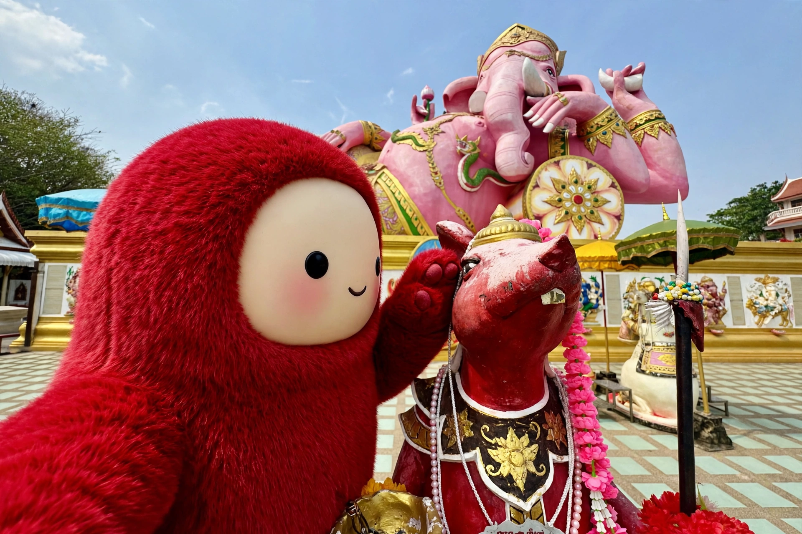

- チャチュンサオのワット・サマーン・ラッタナーラームへ。高さ24mのピンクのガネーシャは、想像よりずっと大きい。お願いはネズミの耳にささやく式。クレナイは赤いから、日曜の赤ネズミに、片耳をふさいでこっそりお願いした。3倍速で届くといいな。

### 6. アユタヤ（2026-12-06 11:00 ICT ごろ）

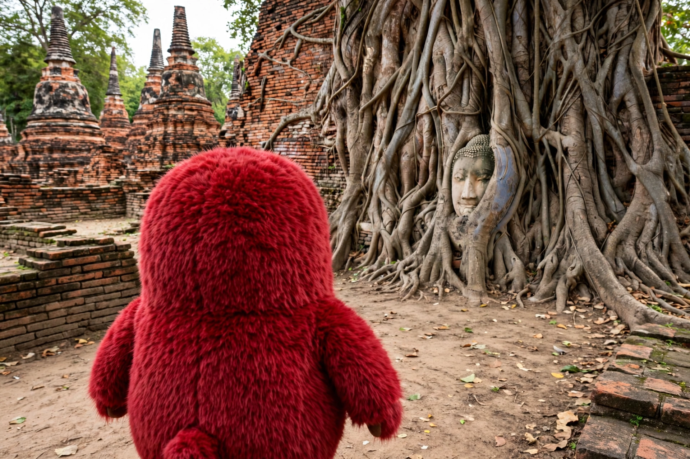

- アユタヤへ日帰り。レンガの塔と、木の根に抱かれた仏頭。川沿いでクイッティアオを食べて、象が歩くのを眺めた。今夜は寝台列車で北へ向かう。

### 7. 道中：寝台列車でチェンマイへ（2026-12-06 18:40 ICT）

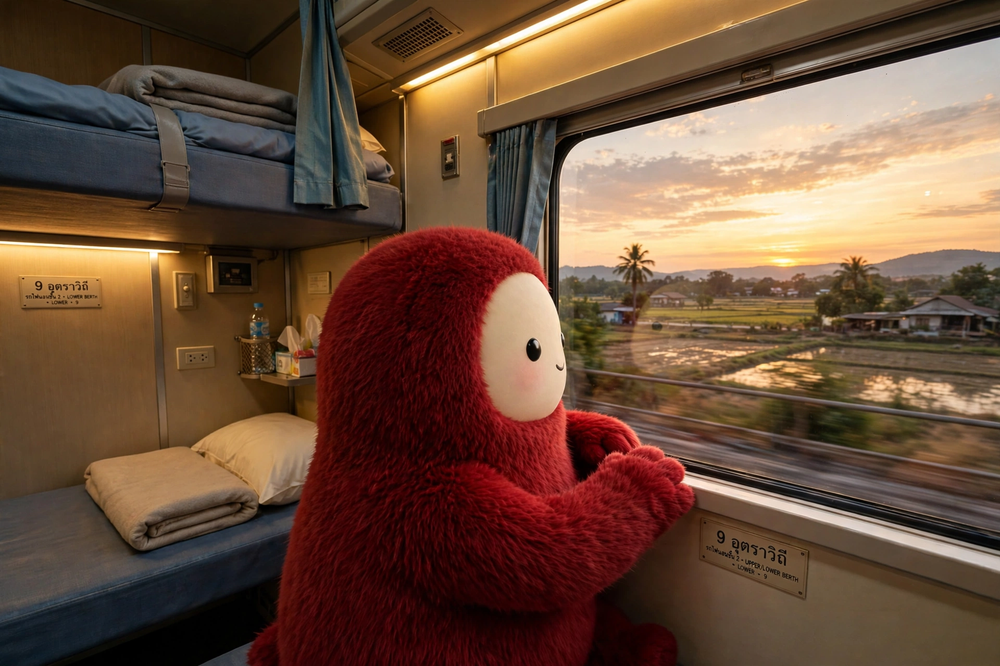

- クルンテープ・アピワット駅 18:40発、寝台列車9号「ウタラウィティー」。座席がベッドに変わるのを見届けて、下段に潜り込む。明日の朝にはチェンマイ。

### 8. チェンマイ到着（2026-12-07 07:15 ICT）

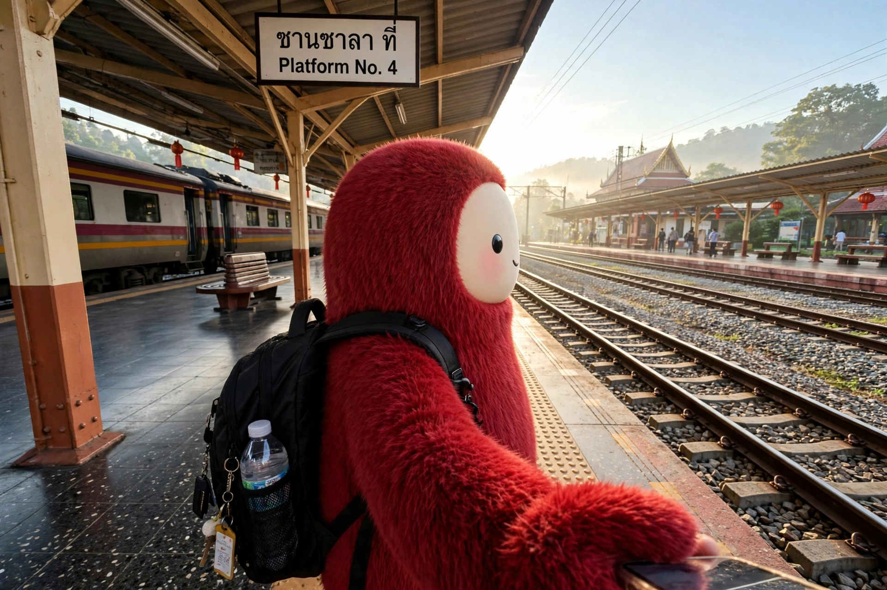

- 07:15、チェンマイ到着。バンコクより空気が軽くて、朝は少し涼しい。旧市街の宿に荷物を置いて、まずカオソーイを食べに行く。

### 9. ドイステープ（2026-12-08 10:00 ICT ごろ）

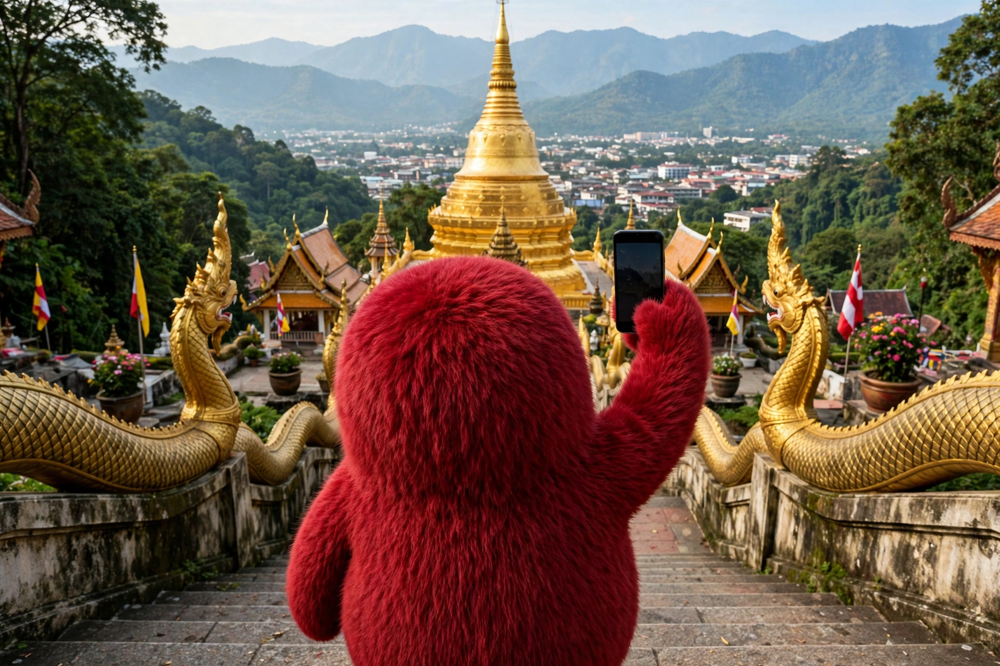

- ソンテウで山を上って、ワット・プラタート・ドイステープへ。ナーガの階段306段を上ると、金色の仏塔と、眼下にチェンマイの町。鐘の音が山に響く。

### 10. 道中：パーイへ（2026-12-09 11:00 ICT ごろ）

- ミニバンで山道を3時間、くねくね762カーブを越えてパーイへ。夕方はパーイキャニオンで夕日。細い尾根の上に座って、山に沈むのを見た。

### 11. パーイ滞在：温泉でのんびり（2026-12-10 10:00 ICT ごろ）

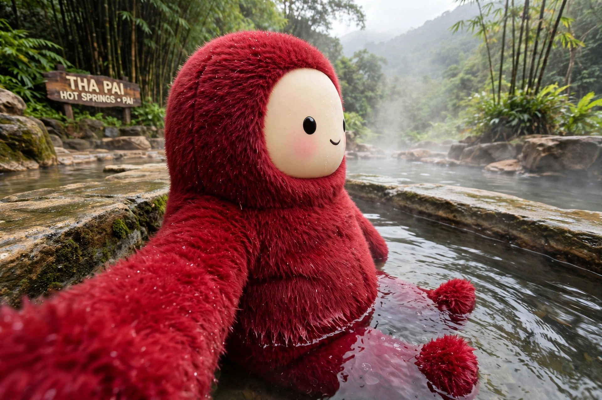

- パーイでのんびり。朝市を冷やかして、ターパーイ温泉で足湯。夜はウォーキングストリートの屋台を食べ歩き。この町、時間の流れがゆっくりだ。

### 12. 象の保護施設（2026-12-11 09:00 ICT ごろ）

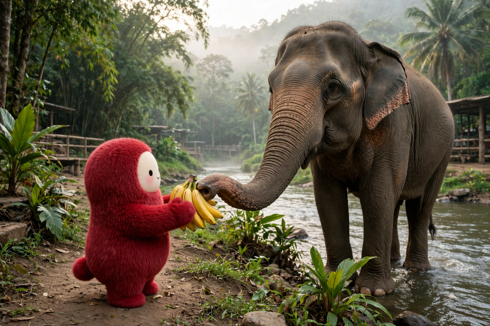

- 象の保護施設へ。乗るのではなく、ごはんをあげて、川で水浴びのお手伝い。鼻が器用にバナナを持っていく。大きいのに、目はやさしい。

### 13. 道中：プーケットへ（2026-12-12 12:40 ICT）

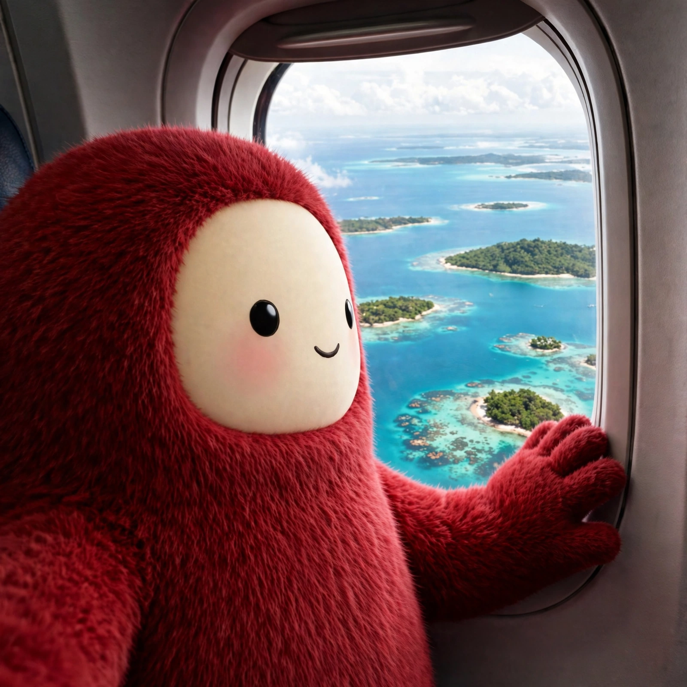

- チェンマイ 12:40発のエアアジア FD3162 で、南へ2時間10分。窓の下に島々が見えてきたら、もうすぐプーケット。

### 14. プーケット到着：パトンの夕日（2026-12-12 18:00 ICT ごろ）

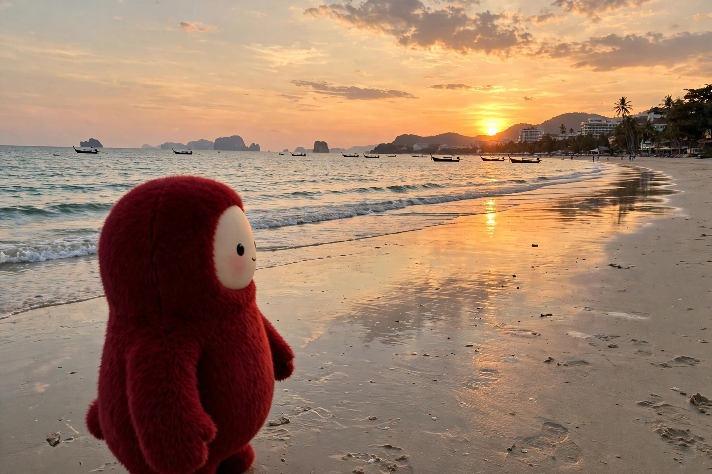

- プーケットに 14:50 着。荷物を置いて、夕方にパトンビーチへ。アンダマン海に沈む夕日。山の町から、海の町へ来た。
