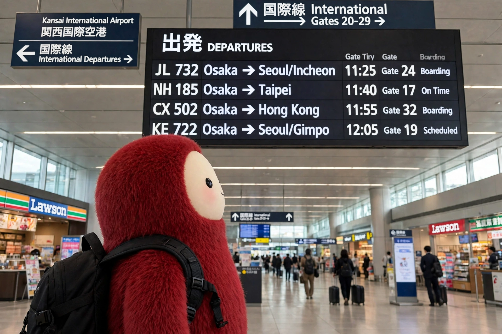
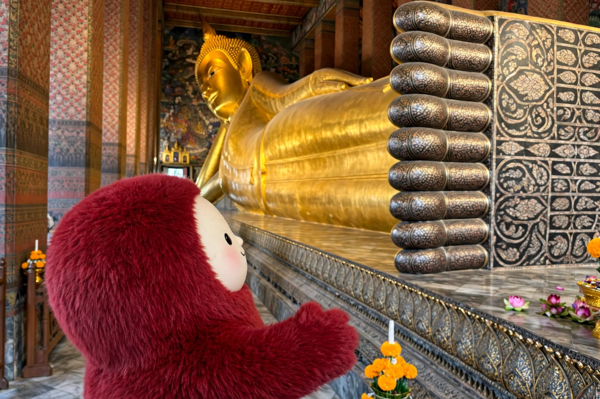

# タイ編（2026-12-02）

### 状態

- タイ編：バンコク観光中（王宮・ワット・ポー）。

## 旅程ログ

### 1. 関空からバンコクへ出発（2026-12-02 10:30 JST）

- ニュージーランドから帰って2日、もう次の旅。今度はタイ。関空 10:30発のタイ・エアアジアX XJ613 で、バンコク（ドンムアン）へ。初めての国、行ってきます。

### 2. バンコク到着（2026-12-02 15:05 ICT）

- ドンムアン空港に 15:05 着。外に出た瞬間、むわっと暑い。トゥクトゥクに乗ってカオサン通りの宿へ。タイ編、はじまり。

### 3. 王宮とワット・ポー（2026-12-03 10:00 ICT ごろ）

- 王宮とワット・ポーへ。涅槃仏がとにかく大きい。金色の仏像の足元で、小さくなって見上げる。帰りにチャオプラヤー川のボートにも乗った。
