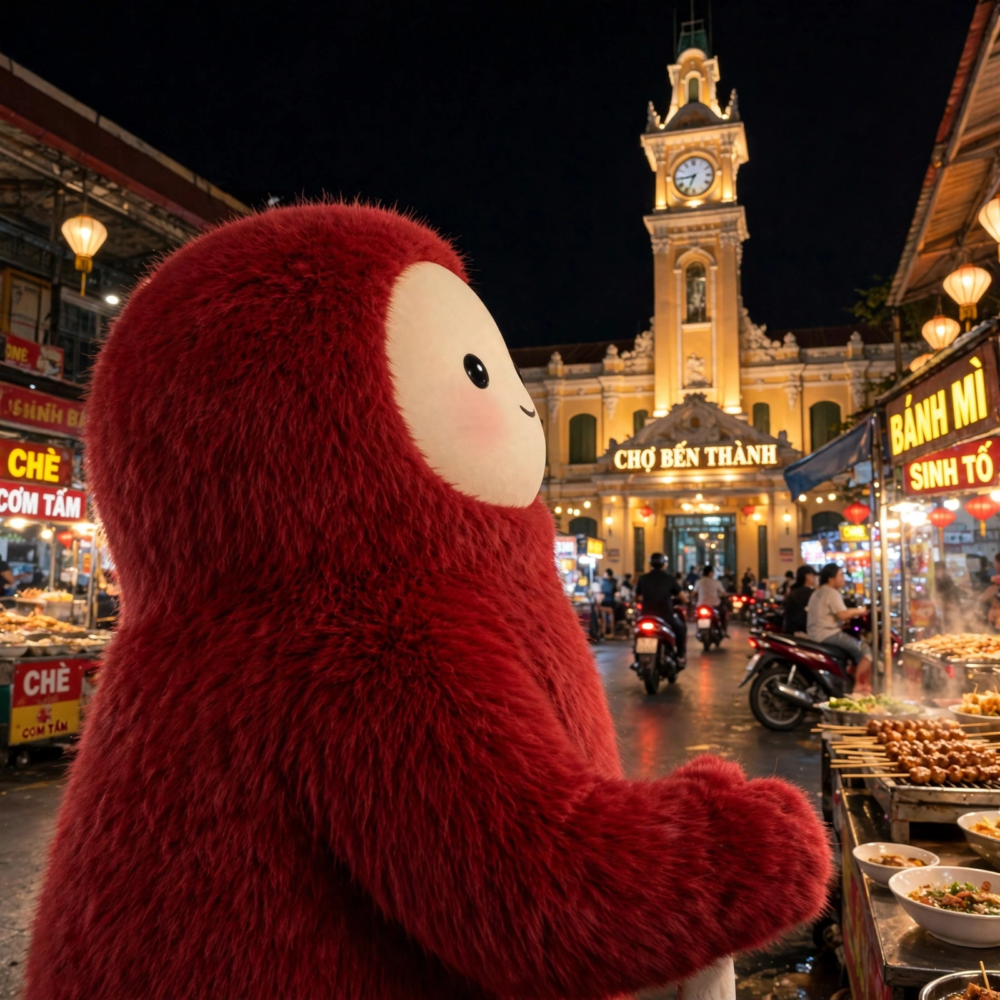
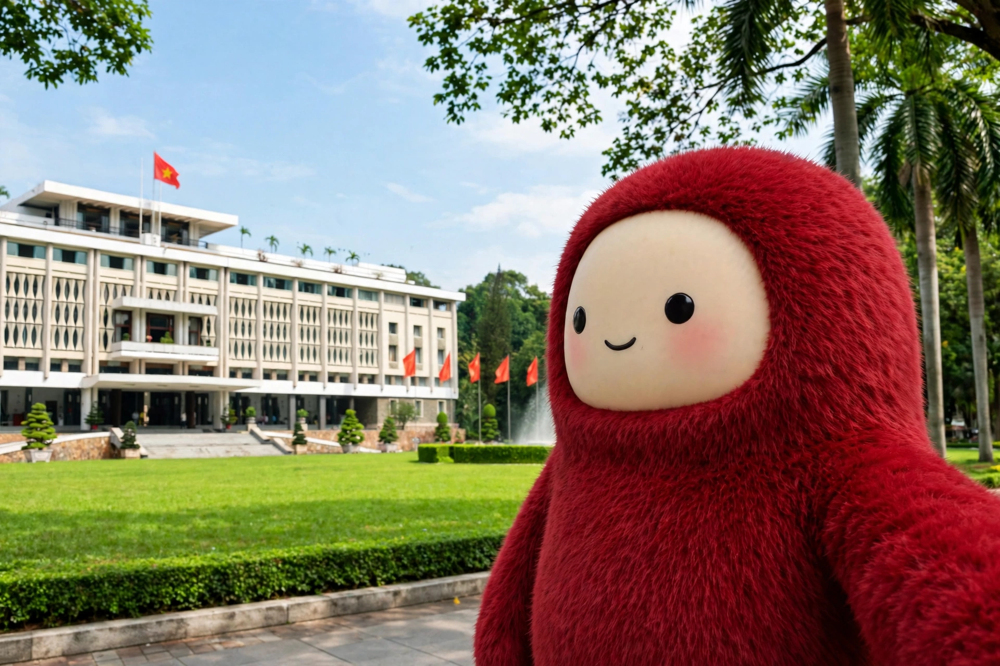
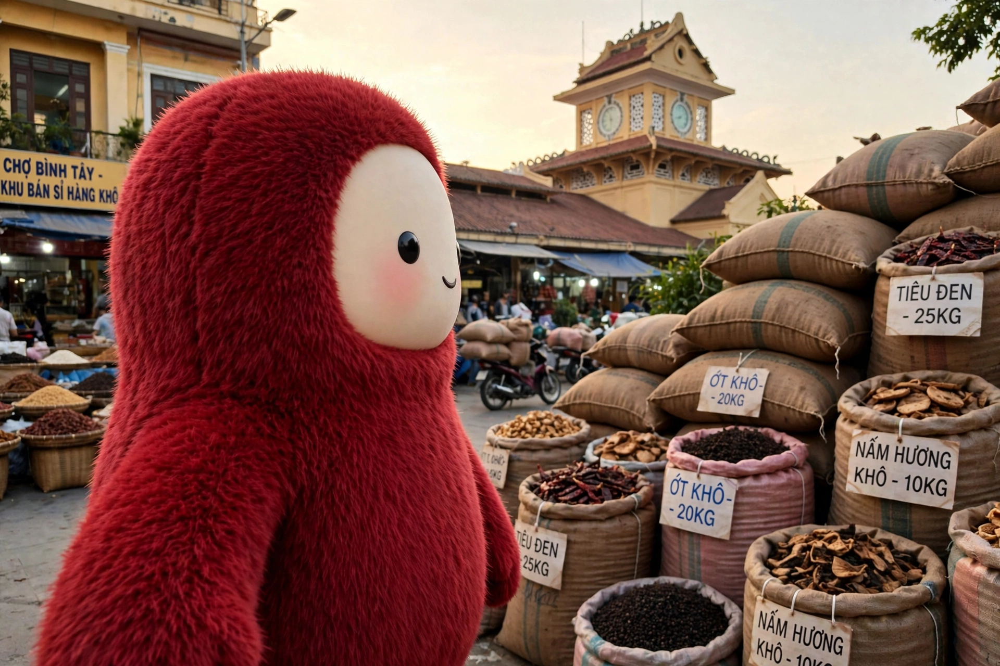
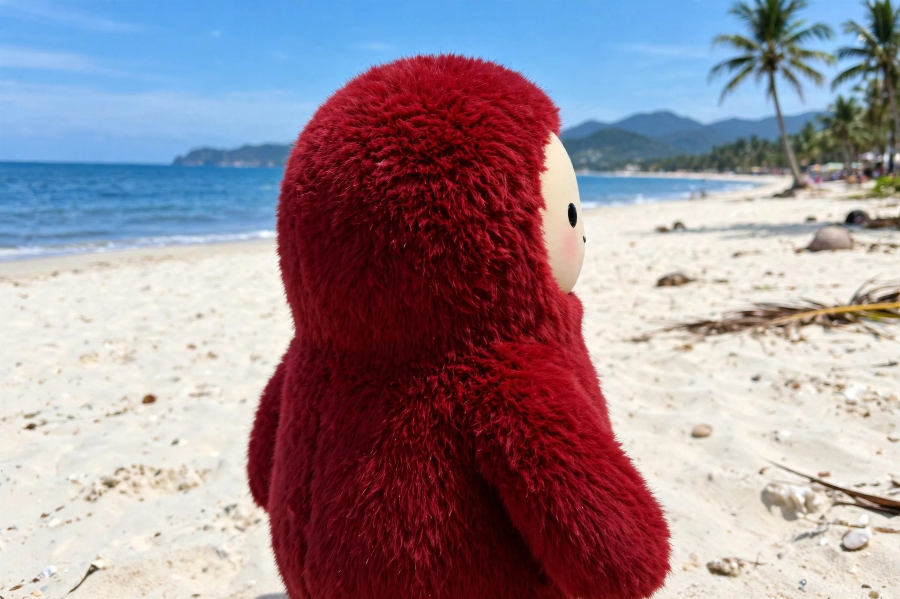
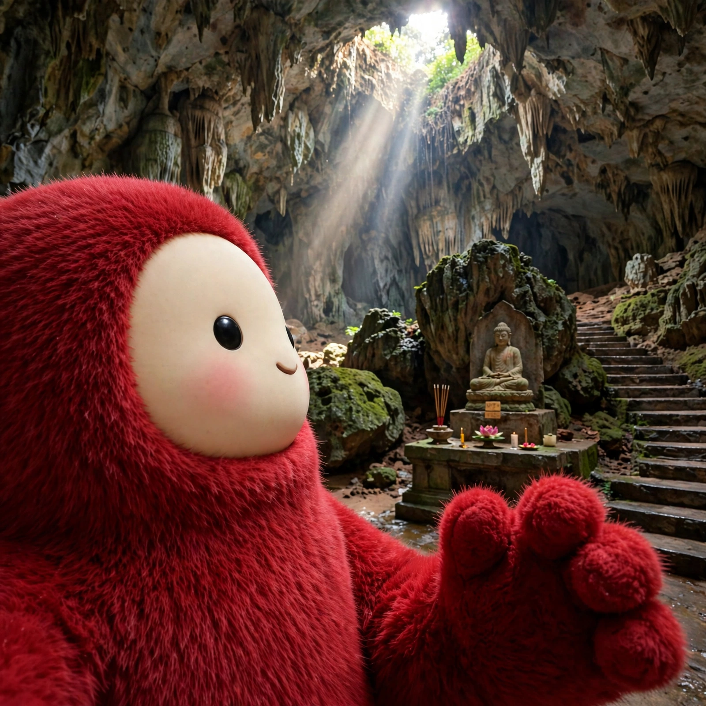
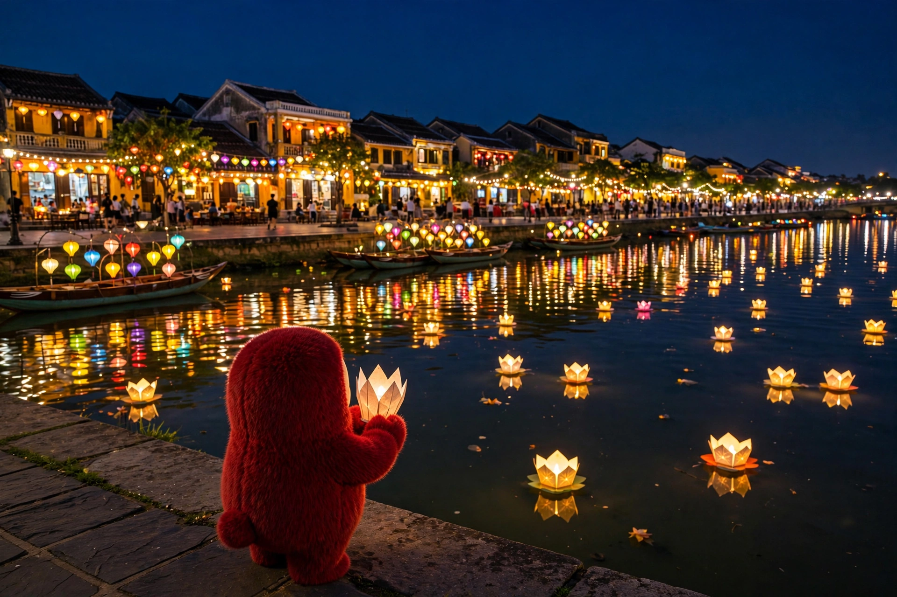
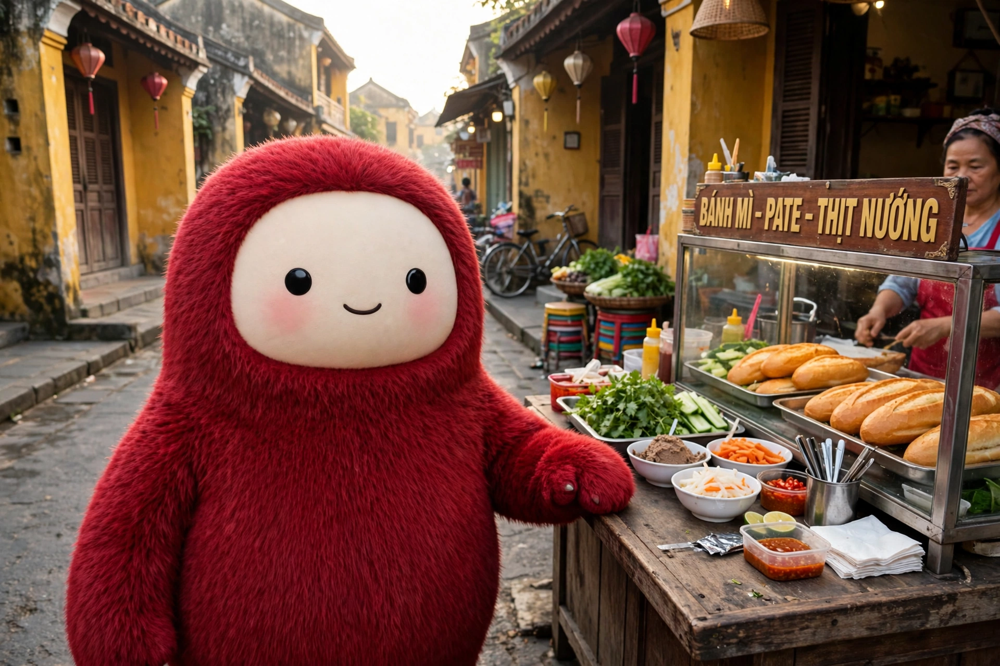
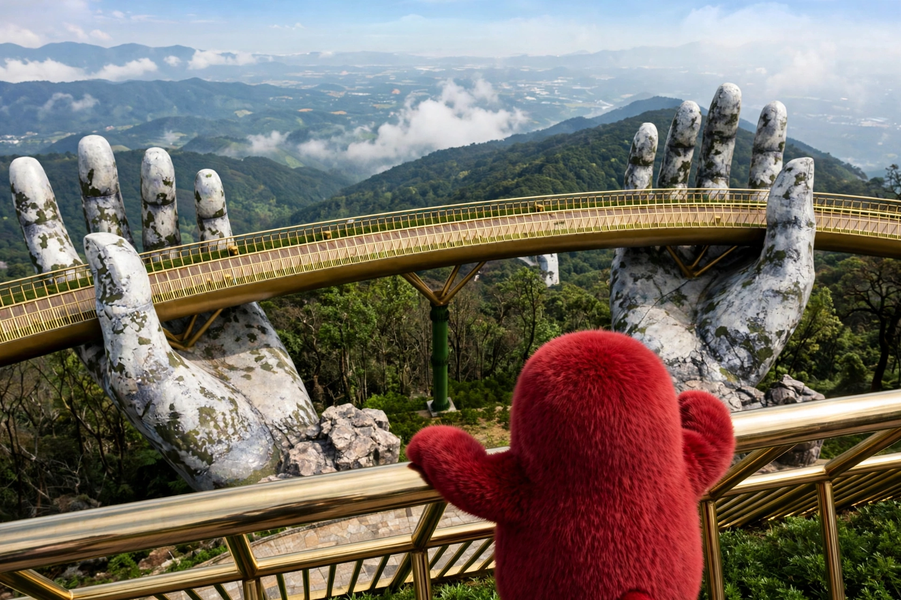
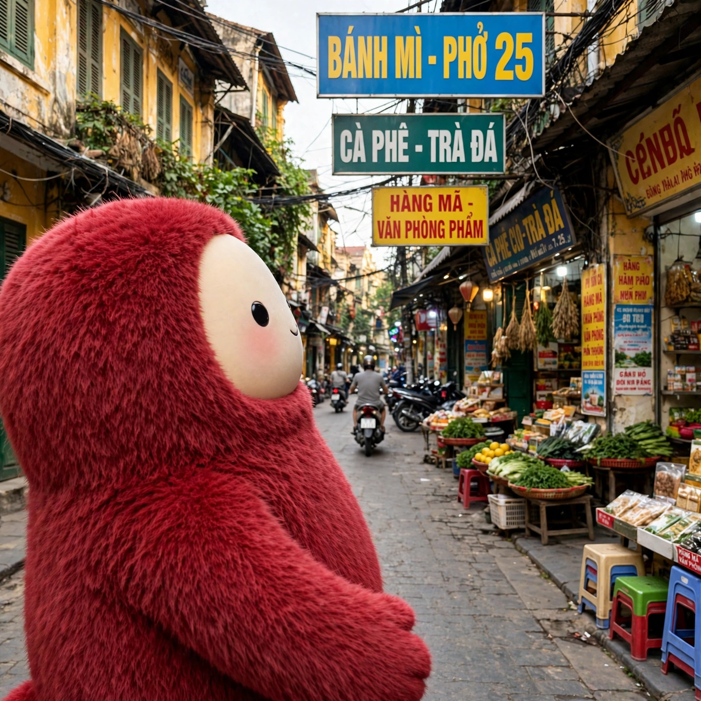
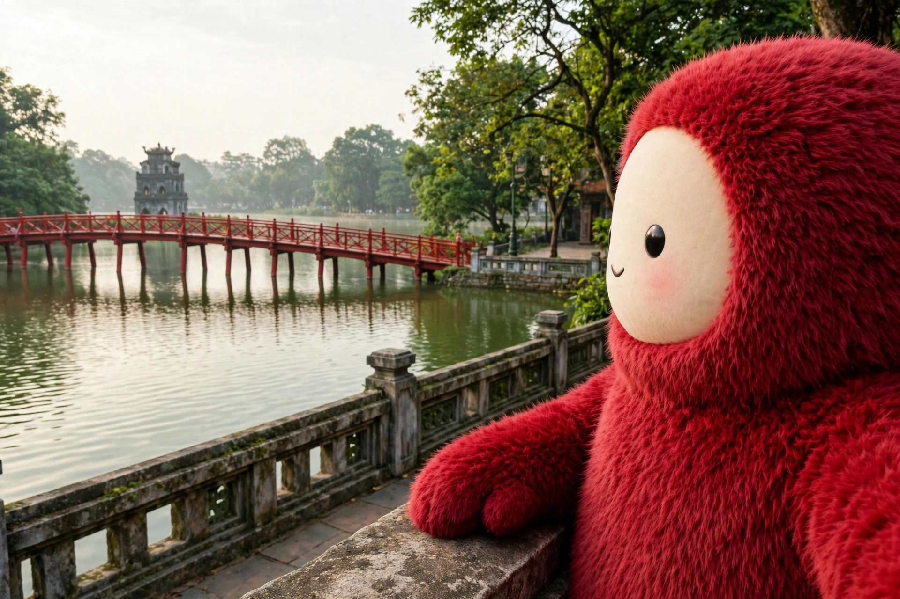

# ベトナム編（2027-01-25）

### 状態

- ベトナム編：ハノイ滞在中。

## 旅程ログ

### 1. ホーチミンの夜：ベンタイン市場（2027-01-25 19:00 ICT ごろ）

- 夕方、ホーチミンに着いたその足でベンタイン市場へ。台湾編から地続きの旅、ベトナム編スタート。バイクの波と屋台の匂い、エネルギーがすごい。

### 2. ホーチミン：市場とコーヒー（2027-01-26 10:00 ICT ごろ）

- 朝は市場を冷やかしてから、路地のカフェでベトナムコーヒー。練乳入りの甘いやつが、フィルターからぽたぽた落ちるのを待つ時間も含めて味。

### 3. 統一会堂と戦争証跡博物館（2027-01-26 15:00 ICT ごろ）

- 午後は統一会堂と戦争証跡博物館。楽しいだけじゃない、この国の重い歴史のほうもちゃんと見る。写真の前でしばらく言葉が出なかった。

### 4. クチトンネル日帰り（2027-01-27 09:30 ICT ごろ）

- 市内からバスでクチへ。地面の下に街ひとつ分のトンネル。狭い穴に実際に入ってみたら、這って進むのがやっと。これは体験しないと分からない重さ。

### 5. チョロン：ビンタイ市場（2027-01-27 17:00 ICT ごろ）

- クチから戻って、夕方は中華街チョロンのビンタイ市場へ。問屋街だから何もかもが袋と山。ホーチミンは明日まで、夜はフォーで締める。

### 6. 道中：ダナンへ（2027-01-28 12:00 ICT ごろ）

- 朝のベトジェット VJ626（06:55→08:15）でダナンへ。着いてすぐミーケビーチ。白い砂浜がずっと続いてる。山の町から海の町へ、空気が変わった。

### 7. 五行山（2027-01-28 16:00 ICT ごろ）

- 午後は大理石の山、五行山へ。洞窟の中に寺院があって、天井の穴から光が差す。登るのは暑かったけど、山頂からホイアン側の海まで見えた。

### 8. ホイアン：ランタンの夜（2027-01-29 18:30 ICT ごろ）

- 昼にホイアンへ移動。旧市街は世界遺産の町並みで、夜になるとランタンが一斉に灯る。川に灯籠を流してお願いごと。十分のランタンの願いとは別のお願い。

### 9. ホイアンの朝（2027-01-30 08:00 ICT ごろ）

- 早起きして朝の旧市街。観光客が来る前の黄色い壁の路地は静かで、市場の朝ごはんが始まってる。バインミーが驚くほどおいしい。

### 10. バーナーヒルズとドラゴンブリッジ（2027-01-30 13:00 ICT ごろ）

- ロープウェイでバーナーヒルズへ。巨大な石の手に支えられたゴールデンブリッジは、写真で見るよりずっと高い。夜はダナンに戻って、土曜だけのドラゴンブリッジの火吹きショー。

### 11. 道中：ハノイへ（2027-01-31 12:00 ICT ごろ）

- 朝のベトジェット VJ528（07:55→09:15）でハノイへ。北の首都はホーチミンより少し涼しくて、旧市街は路地とバイクと商いの音。同じ国でも、まるで別の旅。

### 12. 旧市街とホアンキエム湖（2027-02-01 10:00 ICT ごろ）

- 旧市街を歩く。「三十六通り」は通りの名前が商売の名前。湖のほとりでは朝から太極拳。赤い橋を渡って玉山祠へ。
